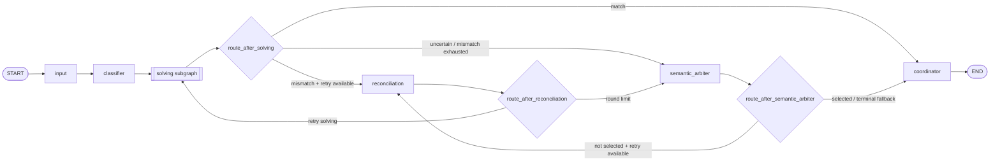
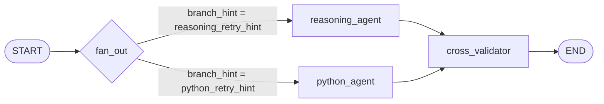
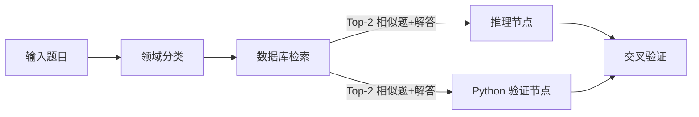

# ICMA-A Graph Architecture Based Mathematical Intelligence Agent System

## 本项目采用 AGPLv3.0 许可证，任何使用需遵守开源义务

> **赛事荣誉**：本项目荣获 **2026 年度中国青年科技创新“揭榜挂帅”擂台赛国家级特等奖（全国第四名）**。该赛事面向国家重大需求与产业关键核心技术难题，以“揭榜挂帅”机制征集解决方案；本项目以图架构数学智能体系统参赛并获此成绩。

本项目是一个面向数学题自动求解的多智能体系统。系统以 LangGraph 为编排框架，将数学题求解拆成 **领域分类、LLM 推理、Python/SymPy 验证、答案交叉校验、语义仲裁、冲突调解、最终协调输出** 七类阶段，其中语义仲裁与冲突调解按路由条件触发。目标是在挑战杯评测接口中稳定返回结构清晰、答案明确、可追踪的 `final_response`。

项目入口保持竞赛约定：评测侧可以直接导入 `user_agent.py` 中的 `ReasoningAgent`，调用 `solve(problem, metadata)` 获得结果。本地调试时也可以运行 `main.py`，批量读取 JSONL 输入并为每道题写出独立 JSON 结果。

文档导航：核心求解器的逐节点数据流见 [`数据流.md`](数据流.md)；本地网页工作台的完整
启动、接口、并发聊天和 SSE 说明见本文第 14 节，简版启动说明见
[`WEB_DEMO_README.md`](WEB_DEMO_README.md)。

---

## 1. 项目定位

### 1.1 解决的问题

数学题自动求解常见问题包括：

- LLM 能写出推理，但数值计算、矩阵计算、积分求值等步骤可能出错。
- Python/SymPy 能做可计算验证，但证明题、条件解释、多问枚举和结论表达容易不完整。
- 领域判断错误会导致提示词、验证脚本和解题策略全部偏移。
- 输出如果只保留一个数字，可能丢失假设检验结论、置信区间双端点、运输方案、枚举对象等题面要求。

本系统采用图架构解决这些问题：先把题目路由到数学领域，再让 LLM 推理和 Python 验证并行生成候选答案，随后用规则与符号等价判定做交叉验证。确定性证据不足时，语义仲裁器只能从既有候选中选择完整答案或弃权；需要修正时回到子图重试，最后由协调节点生成符合评测期望的最终答案。

### 1.2 核心特性

- **LangGraph 主图 + 子图**：主图负责整体控制流，solving 子图负责双路并行求解。
- **数学竞赛题库检索**：从 4 万道奥数题库（IMO、APMO、AMC 等）中检索最相似的 2 道题目+解答作为参考，供推理和验证节点使用。
- **18 个数学领域 skill 文档**：按领域加载 `skills_pythonscripts/<领域>/<领域>skill.md` 作为解题参考，并按题目主题选取相关模块而非截取开头。
- **领域验证知识提示**：按领域加载 `验证示例.py` 中的说明、知识点、核验清单和短代码片段，指导 Python agent 生成与题面相符的验证代码。
- **墙钟预算优先**：单题 20 分钟硬限制由 `utils/time_budget.py` 统一管理；重试按上次实测耗时定价，可选阶段在预留时间内降级为确定性路径，而不是超时后交白卷。
- **assistant 预填充**：分类与仲裁用预填充让推理模型跳过 CoT，分别从 40.4s/1969 tokens、70.2s/~2000 tokens 降到 ~1s/12 tokens、0.8s/4 tokens。
- **统一模型配置**：所有 LLM 节点默认使用 `intern-s2`，共享 `CONFIG["model"]`，并支持通过 `INTERN_MODEL` 显式覆盖。
- **LLM + SymPy 双路验证**：推理答案和程序答案独立生成，再做一致性判断。
- **答案契约检查**：针对多问、置信区间、假设检验、运输问题、枚举题等场景检查答案完整性。
- **匿名候选语义仲裁**：不依赖题型关键词穷举，隐藏显式来源标签并随机化顺序以降低偏差；只能选择既有候选或弃权，不能生成、拼接或改写数学答案。
- **冲突调解与重试**：当两路答案不一致或 Python 执行失败时，生成定向提示重跑 solving 子图。
- **可审计 trace**：输出包含分类、推理、Python 验证、交叉验证、语义仲裁、调解、协调等阶段摘要。
- **断点续跑**：本地批处理时，已存在且非空的 `{idx}.json` 会自动跳过。

---

## 2. 目录结构

```text
.
├── main.py                         # 本地批处理入口：读 JSONL，并发调用 agent，写 JSON 输出
├── user_agent.py                   # 竞赛接口：ReasoningAgent.solve(problem, metadata)
├── langgraph_math_agent.py         # 主图构建：分类、求解、调解、语义仲裁与最终协调
├── llm_client.py                   # OpenAI-compatible HTTP Chat 客户端，读取 INTERN_API_KEY
├── config.py                       # 全局配置：模型名、超时、重试、温度、token 预算
├── requirements.txt                # 运行依赖
├── database/                       # 数学竞赛题库（27,984 条，~1 GB）
│   ├── chroma.sqlite3              # ChromaDB 持久化文件
│   ├── <uuid>/                     # HNSW 向量索引
│   └── ...
├── models/                         # 嵌入模型权重（已包含，无需下载）
│   └── Qwen3-Embedding-0.6B/       # Qwen3-Embedding-0.6B (1.15 GB)
│       └── snapshots/master/       # 模型文件（config, safetensors, tokenizer 等）
├── graph/
│   ├── __init__.py
│   └── solving_subgraph.py         # solving 子图：reasoning_agent 与 python_agent 并行扇出
├── nodes/
│   ├── __init__.py
│   ├── input_node.py               # 初始化 idx
│   ├── classifier_node.py          # 领域分类：关键词/优先级/LLM JSON 分类/类别归一
│   ├── database_retrieval_node.py  # 数据库检索：从奥数题库检索相似题目+解答
│   ├── reasoning_agent_node.py     # LLM 结构化推理与最终答案抽取
│   ├── python_agent_node.py        # 生成 Python/SymPy 验证代码并执行
│   ├── cross_validator_node.py     # 推理答案与 Python 答案交叉验证，决定下一跳
│   ├── reconciliation_node.py      # 不一致时生成重试提示，控制重跑轮数
│   ├── semantic_arbiter_node.py     # 从既有候选中选择完整答案或弃权
│   └── coordinator_node.py         # 汇总上下文，生成并格式化最终响应
├── state/
│   ├── __init__.py
│   └── math_agent_state.py         # MathAgentState：全图共享状态 TypedDict
├── utils/
│   ├── __init__.py
│   ├── deps.py                     # LangGraph configurable 依赖注入容器
│   ├── database_client.py          # ChromaDB 客户端：奥数题库语义检索
│   ├── llm_retry.py                # LLM 调用重试与指数退避
│   ├── logger.py                   # stderr 日志，支持 python-json-logger
│   ├── token_budget.py             # 粗粒度 token 预算估算与 tight 模式
│   ├── timeout_control.py          # 通用超时包装
│   ├── prompt_templates.py         # 分类/推理/Python/语义仲裁/协调 Prompt 模板
│   ├── skills_loader.py            # 领域扫描、skill 文档加载、关键词检索
│   ├── category_embedding_index.py # TF-IDF 领域相似度索引
│   ├── python_mcp_client.py        # Python executor 客户端，优先子进程，失败本地回退
│   ├── answer_matcher.py           # 数值/符号/字符串/证明题匹配
│   ├── structured_answer.py        # 结构化数学字段提取与等价比较
│   ├── answer_contract.py          # 题面字段契约与缺失组件检测
│   ├── answer_extractor.py         # 多问/残缺/LaTeX 片段等答案抽取工具
│   ├── answer_formatter.py         # 最终答案格式化与完整性回捞
│   ├── cot_stripper.py             # 去除模型 CoT 前缀和占位答案检测
│   ├── conclusion_salvage.py       # 无章节输出时从散文中捞回结论句
│   ├── skill_excerpt.py            # 按题目主题选取 skill 文档/验证知识提示片段
│   ├── prefill.py                  # assistant 预填充：让推理模型跳过 CoT
│   ├── time_budget.py              # 单题墙钟预算：三条时限与实测耗时记录
│   ├── retry_affordability.py      # 按上次实测耗时判断重试是否负担得起
│   ├── client_tuning.py            # 尽力提升平台 client 的 socket 超时
│   ├── reconciliation_policy.py    # 调解轮次和 tight-budget 重试策略
│   └── error_handler.py            # 节点异常包装，写入 errors
├── mcp_servers/
│   └── python_executor/
│       ├── __init__.py
│       └── server.py               # Python 代码执行工具，可作为 FastMCP server 独立启动
├── tests/                           # 离线 unittest 回归测试
└── skills_pythonscripts/
    ├── 数学分析/
    ├── 高等代数/
    ├── 抽象代数/
    ├── 概率论/
    ├── 统计推断/
    ├── 线性回归/
    ├── 随机过程/
    ├── 复分析/
    ├── 常微分方程/
    ├── 偏微分方程/
    ├── 泛函分析/
    ├── 测度积分/
    ├── 拓扑学/
    ├── 微分几何/
    ├── 数值分析/
    ├── 离散数学/
    ├── 运筹学/
    └── 非基础及进阶课程/
```

每个数学领域目录通常包含两个文件：

- `<领域>skill.md`：领域概念、典型题型、解题流程和注意事项。
- `<领域>验证示例.py`：保留历史文件名，内容采用“自然语言提示 + fenced Python/SymPy 片段”形式；按对应 skill 的主知识模块逐项配备模块级核验片段，包含适用条件、核验顺序和输出契约，供 `python_agent` 参考。

这些 `验证示例.py` 是运行时提示资料，不是可直接运行的完整程序。Python agent 按题目主题选取相关代码片段、替换为题面变量并补成独立验证代码，不能执行整份提示或照抄无关片段。

`非基础及进阶课程` 覆盖 9 个模块：实变函数论、泛函分析、抽象代数、拓扑学、复变函数、微分几何、数值分析、**初等数论**、**博弈论**。后两个模块的要点：

- **初等数论**：乘法阶与 Carmichael 函数 $\lambda(n)$（涉及 2 的幂次时必须用 $\lambda$ 而非 $\varphi$）、升幂引理 LTE、函数方程型整除问题的标准步骤。
- **博弈论**：必胜/必败态倒推、Sprague–Grundy 与 Nim 异或判据、连续型策略博弈用 Cauchy–Schwarz 定阈值、阈值题必须三段作答（临界点常常两方都不必胜）。

对应验证提示要求先识别题型、说明不变量与边界条件，再选取相应代码片段并以题面数据补全；代码对有限实例的检查不构成对一般结论的证明。

**极值型问题的双侧原则**（写入 skill 文档的跨学科方法论）：求"最小常数 $c$"这类问题必须由上界推导与下界构造两个独立论证夹出，任一侧缺失即答案未定。任何声称的构造都必须按题面条件逐条核验；未经核验的构造不构成下界。

---

## 3. 模型系统架构

### 3.1 总体图结构

主图定义在 `langgraph_math_agent.py`，状态类型为 `MathAgentState`。



主图节点职责：

| 节点 | 输入关键字段 | 输出关键字段 | 说明 |
|---|---|---|---|
| `input` | `metadata`, `idx` | `idx` | 提取题目编号，保证状态中存在 `idx`。 |
| `classifier` | `problem` | `category`, `category_confidence`, `candidate_categories` | 将题目归入真实存在的数学领域目录。 |
| `solving` | `problem`, `category`, retry hints | `reasoning_result`, `python_output`, `validation_status`, `validated_answer`, `next_node` | 子图内部并行求解并交叉验证。 |
| `reconciliation` | `validation_status`, `python_output`, `reasoning_result` | `reasoning_retry_hint`, `python_retry_hint`, `reconciliation_round`, `next_node` | 按确定性策略生成重试提示；达到轮次上限时转语义仲裁。 |
| `semantic_arbiter` | 原题、至多两个候选及验证证据 | `semantic_arbiter_status`, `semantic_arbiter_decision`, `validated_answer`, `answer_locked`, `next_node` | 候选不足两个时安全跳过；否则只选择一个既有完整候选或弃权。 |
| `coordinator` | 推理、Python、验证、仲裁和调解状态 | `final_response`, `coordination_detail` | 普通路径生成并格式化说明；锁定路径逐字保留仲裁候选。 |

### 3.2 Solving 子图

`graph/solving_subgraph.py` 使用 LangGraph `Send` 从 START 同时扇出到两个 agent：



子图中的两条求解链路相互独立：

- `reasoning_agent` 只依赖题面、领域 skill 文档和重试提示，输出结构化推理。
- `python_agent` 只依赖题面、领域验证示例脚本和重试提示，输出可执行代码及执行结果。
- `cross_validator` 汇总两路结果，决定直接接受、进入调解或交给语义仲裁。

### 3.3 依赖注入

`MathAgentGraph.run()` 会构造 `Deps` 并放入 LangGraph `configurable`：

```text
Deps(
  client=InternChatClient 或评测平台官方 client,
  skills_loader=SkillsLoader(),
  mcp_client=PythonMCPClient(),
  token_budget=TokenBudget(),
  logger=...
)
```

各节点通过 `utils.deps.get_deps(config)` 取依赖。这样节点函数保持纯函数形态，评测侧也可以用官方 client 初始化 `ReasoningAgent`。

### 3.4 状态模型

全图共享状态定义在 `state/math_agent_state.py`。关键字段如下：

| 阶段 | 字段 | 含义 |
|---|---|---|
| 输入 | `problem` | 原始题面文本。 |
| 输入 | `metadata` | 调用方传入的元信息，至少可能包含 `idx`。 |
| 输入 | `idx` | 题目编号；本地批处理未提供时使用 JSONL 行号。 |
| 输入 | `question_mode` | 题型画像：`computation`、`proof`、`choice`、`true_false` 或 `fill`；可由元数据覆盖，否则从题面稳健识别。 |
| 分类 | `category` | 归一后的数学领域名，必须是 `skills_pythonscripts/` 下真实目录名。 |
| 分类 | `candidate_categories` | 可选领域候选列表。 |
| 推理 | `reasoning_result` | `analysis`, `steps`, `answer`, `validation_points`。 |
| 推理 | `reasoning_trace` | 推理节点内部重试记录。 |
| Python | `python_code` | 由模型生成并被执行的 Python 代码。 |
| Python | `python_output` | `success`, `stdout`, `stderr`, `answer`, `execution_time`, `execution_backend`。 |
| 验证 | `validation_status` | `match`, `mismatch_reconciling`, `mismatch_arbitrating`, `uncertain_arbitrating`, `reconciliation_exhausted_arbitrating` 等。 |
| 验证 | `validated_answer` | 当前阶段选择出的答案。 |
| 调解 | `reconciliation_round` | 已调解轮数。 |
| 调解 | `reasoning_retry_hint`, `python_retry_hint` | 下一轮 solving 子图的定向提示。 |
| 仲裁 | `semantic_arbiter_status` | `selected`, `abstained`, `invalid_format`, `skipped`, `budget_exhausted`, `error` 等。 |
| 仲裁 | `semantic_arbiter_decision` | 成功选择时为 `reasoning` 或 `python`。 |
| 仲裁 | `semantic_arbiter_trace`, `semantic_arbiter_attempts` | 仲裁轮次、候选数量、选择来源或失败原因。 |
| 仲裁 | `answer_locked` | 为 `true` 时，coordinator 不再改写或格式化已选候选。 |
| 输出 | `final_response` | 最终返回给评测系统的答案。 |
| 输出 | `coordination_detail` | 普通路径保存 coordinator 原始说明；答案锁定时为空字符串是正常行为。 |
| 控制 | `next_node`, `should_terminate` | 图路由控制字段。 |
| 预算 | `token_budget_consumed` | 预留字段；实际预算由 `TokenBudget` 对象维护。 |

---

## 4. 端到端数据流

### 4.1 本地批处理入口

`main.py` 做四件事：

1. `load_jsonl(input_file)` 逐行读取输入。空行跳过；如果行内没有 `idx`，使用行号作为默认 `idx`。
2. 创建 `InternChatClient()` 和 `ReasoningAgent(client=client)`。
3. 按 `LOCAL_MAX_CONCURRENCY` 创建并发任务；默认并发数是 `8`。
4. 每道题写到 `{output_dir}/{idx}.json`。如果目标文件已存在且非空，则跳过该题，支持断点续跑。

输入 JSONL 最小格式：

```json
{"idx": 0, "problem": "设 f(x)=x^2，求 f'(3)。"}
```

`idx` 推荐显式提供；如果省略，本地 runner 会用该行的行号。

### 4.2 ReasoningAgent 接口

评测平台或业务代码可以直接调用：

```python
from llm_client import InternChatClient
from user_agent import ReasoningAgent

client = InternChatClient()
agent = ReasoningAgent(client=client)

result = agent.solve(
    problem="设 f(x)=x^2，求 f'(3)。",
    metadata={"idx": 0},
)
print(result["final_response"])
```

`solve()` 内部流程：

1. `create_initial_state(problem, metadata)` 生成初始状态。
2. `MathAgentGraph.run(initial_state, token_budget=TokenBudget())` 执行图。
3. 从最终状态中取 `final_response`，并调用 `_build_trace()` 组装审计信息。
4. `_validate_output()` 确认返回值是可 JSON 序列化的 dict，且 `final_response` 是非空字符串。

异常时不会抛出给 runner，而是返回：

```json
{
  "final_response": "解题过程中出现错误，无法给出完整答案。",
  "trace": [{"step": "error", "content": "...", "idx": 0}]
}
```

### 4.3 分类阶段

`nodes/classifier_node.py` 的目标是得到一个真实可加载的 `category`。

题面直接进入分类 LLM，一次调用覆盖全部 18 个领域：

1. `SkillsLoader._scan_category_names()` 扫描 `skills_pythonscripts/` 下所有目录，全部作为候选。
2. 用 `CLASSIFICATION_PREFILL`（`{"category": "`）做 assistant 预填充调用，`max_tokens=96`。
3. 解析出的领域经 `_resolve_category()` 归一化；置信度达到 `classifier_confidence_threshold` 即接受。
4. **只要预填充给出了一个真实领域名就采信**，即使置信度低于阈值（记 `low_confidence_accepted`）。
5. 仅当预填充完全无法解析时，才退回不带预填充的完整调用（`max_tokens.classifier_fallback`，允许完整 CoT）。
6. 该调用也失败、或墙钟已进入 fast path 时，确定性回退到关键词 + TF-IDF 合并排序的 top1。

`classification_stages_used` 记录实际经过的 `llm_prefill`、`low_confidence_accepted`、`llm_plain`、`llm_plain_accepted`、`deterministic_fallback` 阶段。

**为什么低置信度不再升级**（2026-07-29 实测）：不带预填充的调用在难题上实测 129.5s 与 133.3s，而不是判分集上的 ~40s（该调用允许完整 CoT，而 CoT 长度随难度增长）。这占单题可选预算的 18–22%，用来推翻一个 0.7s 就得到的答案；更糟的是它撞上 120s 的节点上限被杀掉，`error_fallback` 连同已有的预填充结果一起丢弃，最终记录成 `stages=['error_fallback']`、置信度 0.0。分类只决定加载哪份 skill 文档，这个选择不值一个题目五分之一的时间。声明成本已从 60s 校正为 `_PLAIN_CALL_SECONDS=150`，节点上限提到 200s，使该调用一旦发起就不会白付。

**为什么是这个形状**（2026-07-29 实测）：旧实现先用关键词 + TF-IDF 粗排出 top-3 再发给 LLM，但判分集 4 题的粗排 4 次全部落空，第一次调用纯属浪费，答案总是来自全量兜底。现在关键词与 TF-IDF 排序仍然保留，但只作为零成本兜底、不再限制 LLM 的候选范围——限制候选正是它有害的地方。排序本身是懒加载的：LLM 正常作答时根本不会构建 TF-IDF 索引。

预填充是这里唯一真正降低延迟的手段。`intern-s2` 是推理模型，`reasoning_content` 与 `content` 共同计入 `max_tokens`，因此单纯压低 `max_tokens` 只会在思考中途截断（`finish_reason="length"`，残缺 CoT 溢出到 `content`），根本产不出答案。预填充让模型进入续写模式、完全跳过推理：分类从 40.4s / 1969 completion tokens 降到 0.9s / 12 tokens，判分集 4/4 正确。详见 `utils/prefill.py`。

分类 prompt 不加载 skill 文档正文；领域 skill 只在分类完成后由 reasoning agent 加载。

LLM 输出会经过 `_resolve_category()` 归一化：

- 精确匹配真实目录名。
- 去掉空白和中英文标点后匹配。
- 子串包含匹配。
- 最长公共子串匹配。
- Levenshtein 相似度兜底。
- 最后回退到关键词检索 top1。

这个步骤保证下游 `get_skill_document(category)` 和 `get_validation_script(category)` 不会因为虚构领域名而失败。

### 4.4 LLM 推理阶段

`nodes/reasoning_agent_node.py` 加载：

- `problem`
- `category`
- `skills_pythonscripts/<category>/<category>skill.md`
- 可选 `branch_hint`

skill 文档不是按位置截断，而是由 `utils/skill_excerpt.py` **按题目主题选取模块**后送入 prompt（上限 3000 字符）。原因：旧实现写 `skill_document[:3000]`，当 `非基础及进阶课程skill.md` 增长到 8949 字符后，其数论模块（偏移 3404）与博弈论模块（偏移 5369）完全落在窗口之外——一道博弈题拿到的是 Lebesgue 测度。选取按 `## 模块` 标题切分并按术语重叠打分，得分最高的模块优先占用预算（必要时截断该模块本身，也优于送出无关模块）；文档无模块结构或无任何匹配时退化为原来的头部截断。`python_agent` 对验证知识提示走同一机制（`select_script_excerpt`，按 `##` 知识点标题切分，上限 2000 字符）。

然后使用 `REASONING_PROMPT` 要求模型输出固定章节：

- `## 问题分析`
- `## 详细解题步骤`
- `## 最终答案`
- `## 关键验证点`

提示词首部是一份**题面口径检查清单**（推理与 Python 分支共用同一套口径），逐条对应实测出现过的失分形态：开区间/严格不等式下的**端点可达性**（由 ≤ 推出的界取不到，临界值须显式构造验证，验证不过则 +1）、**序号对齐**（问“第 k 大/小”时先列 k=1,2,3 的实际对象再套通项）、**不可能性先证伪**（断言“不可能”前先在小规模实例上实际构造；染色/整除性不变量只给必要条件，一块拼图在不变量下贡献不唯一时不构成不可能性证明）、**最简形式**（能用题面条件消去的偏移必须消去）、值域即代数结构、单双尾核对等。

`utils/problem_profile.structure_instruction()` 在此之上按题面语义追加强制步骤：检出"求所有解"、极值题、F₂ 值域、开区间极值、序号问法、可行性+计数双问项时，各追加一段对应的检查单（检不出就不追加，不增加提示词负担）。

节点会解析模型输出，得到：

```json
{
  "analysis": "...",
  "steps": [
    {"step_num": 1, "description": "..."}
  ],
  "answer": "...",
  "validation_points": ["..."]
}
```

答案抽取逻辑会避免常见残缺：

- 多行枚举题保留全部条目。
- 假设检验保留结论句，不只保留统计量。
- 多个等式和结论行一起保留。
- 避免把 LaTeX 公式切成碎片。
- 识别占位答案，如“见上文”“无法确定”等。

**客观题（选择/判断/填空）走短路径**：两行契约（`答案：` + `依据：`）在 40-100s 内完成，是当前质量最高的分支。但"答案在前、依据在后"意味着模型先承诺再核对——对需要实算的客观题（域扩张次数、维数、阶、收敛半径等）这个顺序恰好相反。检出实算标记时改用**先算后答**的三行契约（`核对：` → `答案：` → `依据：`），解析契约不变（取最后一个 `答案：` 标签）。概念辨析类客观题仍走原两行快速路径，实测只在需要实算的题上触发。

如果格式不完整，会在 `CONFIG["max_retries_per_node"]` 范围内重试。Token 预算紧张时，重试次数降为 1；墙钟预算无法负担一次与上次同等开销的调用时（`utils/retry_affordability.py`），**完整重试**直接放弃并记 `retry_unaffordable`。

**分级熔断与分开定价**（2026-08-10 评委建议 1-3）：完整重试与压缩重试是两种不同商品，分开定价。

- 首轮响应超长却解析不出任何章节（token 耗尽，`_looks_token_exhausted`）时，不再重发同规格调用，改发 **prefill 压缩重试**：assistant 种子 `## 问题分析\n` 抑制私有推理，8192 token 全部落在可见章节上（约 150s）。
- 耗尽判定以**捞回之前**的解析状态为准：捞回来源（`salvaged_prose`/`fallback_line`）的答案不算产出。此前捞回先行会把 `answer` 填成中间句，耗尽判定失效、压缩重试永不触发，残片直接出厂（评委报告模式 A，6/30 题）。
- 压缩重试按 **reserve_margin 定价**（`compressed_reserve_margin_s`）：软预算耗尽后仍可动用 reserve，只要求硬上限前剩余 ≥ 压缩估时 + 收尾余量。按软预算一刀切定价时，压缩重试在评委 30 题批次中 0 次放行。
- 压缩指令压的是**推导篇幅，不是答案覆盖度**：题面要求"所有可能的值"、可行性+数量、多问项时，`answer_coverage_clause()` 会把对应的覆盖要求随压缩指令一起发出（复测轮实测：只写"每章从简"会让模型在三值答案里只报一个）。
- **传输失败（含 8 路并发下的 780s 读超时）不再直接弃分支**：同样转入压缩挽救（评委报告模式 B，9/30 题），挽救不可负担或再失败时才落入既有兜底链。最坏情况由 `node_wrapper` 的硬超时掐断，不会击穿单题 20 分钟上限。

**结论捞回**（`utils/conclusion_salvage.py`）：该模型会把答案推导完却没写 `## 最终答案`。实测一道 ISL 级博弈题三次运行分别返回 41424 / 42810 / 43055 字符而解析出零个章节，其中两次最终以 `解题过程中出现错误` 结束（1072s、1165s）——工作做完了却被丢弃。因此当按标题解析不出答案时，从散文尾部捞回一句结论：要求显式结论词（因此/综上/答案是）加实质内容，取最后一句，并通过与正常答案相同的占位符/残片检查。捞回的答案在 `reasoning_result.answer_source` 标记为 `salvaged_prose`，便于判分方区分。

捞回是**最后的兜底而非首选**：按标题正常解析出的答案永不被覆盖，且压缩重试优先于捞回出厂——捞回答案只在压缩重试不可负担或失败时交付。针对"捞回可能捞到中间引理"的已知风险，捞回通道额外过**推导碎片对账门**（`looks_derivation_fragment`）：语篇连接词开头（"Otherwise, …"）、条件对（"0 if i odd, 2 if i even"）、裸符号和（"a+b+c+d"）、英文 true/false 试错记录（"7≥8 false"）四种评委实测泄漏形态一律拒收。失败/耗尽的原始响应节选（头 600 + 尾 1400 字符）随 trace 留证，评审可区分"模型答错"与"解析器漏掉"。

### 4.5 Python 验证阶段

`nodes/python_agent_node.py` 加载：

- `problem`
- `category`
- `skills_pythonscripts/<category>/<category>验证示例.py`
- 可选 `branch_hint`

该文件虽使用 `.py` 后缀，但其内容是提示词与可摘取代码片段，而非完整程序；节点仅将其中与题面相关的章节注入 Python 生成 prompt。

模型必须输出 Python 代码块。代码抽取采用保守策略：

1. 优先提取独立的 Python fenced code block。
2. 如果 fence 不规范，只有内容看起来像代码时才提取。
3. 如果没有 fence，从第一行 `import` 或 `from` 开始提取。
4. 如果没有可信代码，返回空字符串并触发重试，避免执行模型的思维过程文本。

代码缺少 `print("最终答案:", ...)` 时**仍然执行**（stdout 里往往已有结论）；执行成功但连 stdout 挖掘都拿不到结论时，先做**确定性补调用修复**（2026-08-10 评委建议 5）：挑一个可无参调用的函数，直接在代码尾部追加 `print("最终答案:", fn())` 并重新执行——不花任何 LLM 时间，正对"函数定义正确却从未调用"的实测失败形态；修不动才回落到 LLM 补打印重试。与推理分支同规则，Python 生成调用的传输失败/token 耗尽也转入 prefill 压缩重生成（reserve_margin 定价），不再直接弃分支。

代码通过 `PythonMCPClient.execute()` 执行：

- 优先调用 `mcp_servers.python_executor.server.execute_python()`。
- 每次执行都创建独立临时 `.py` 文件。
- 通过子进程运行，超时由 `CONFIG["node_timeouts"]["python_mcp_execute"]` 控制。
- 子进程环境只保留 `PATH`, `HOME`, `LANG`, `LC_ALL`，避免把 API key 等敏感环境变量传给执行代码。
- stdout 中最后一个 `最终答案:` 之后的内容会被抽取为 `answer`。
- 子进程路径异常时，回退 `_exec_in_process()`。

返回示例：

```json
{
  "success": true,
  "stdout": "最终答案: 6\n",
  "stderr": "",
  "answer": "6",
  "execution_time": 0.43,
  "execution_backend": "mcp"
}
```

### 4.6 交叉验证阶段

`nodes/cross_validator_node.py` 调用 `AnswerMatcher.match_answers()`。

题型判断：

- 题面包含“证明”“prove”“show that”“验证”“说明”“推导”“论证”等关键词时，按证明题处理。
- 其他题默认按计算题处理。

计算题匹配策略：

1. 空答案和占位答案直接判为不可匹配。
2. 字符串完全相同则匹配。
3. 可以转成 float 时做数值容差比较。
4. 尝试做符号等价：
   - 归一化 Unicode 符号，如 `π`, `√`, `×`, `÷`, `²`。
   - 将常见 LaTeX，如 `\frac`, `\sqrt`, `\pi`, matrix 环境转成 SymPy 可解析文本。
   - 使用 SymPy `simplify`、矩阵比较和高精度数值比较。
5. 如果符号解析失败，退回字符串相似度。

证明题匹配策略：

- 推理步骤足够完整且 Python 验证成功，置信度较高。
- 推理完整但 Python 验证失败，仍可接受，因为证明题不一定适合程序验证。
- 推理不完整时，倾向不接受。

答案选择策略 `_preferred_answer()`：

- 确定性 matcher 已证明 `match` 且 reasoning 答案完整时，保留更适合阅读的 reasoning 表达。
- `_preferred_answer()` 主要用于不需要仲裁的已验证路径和仲裁无法完成后的安全回退。
- 回退时会比较占位、残缺、题面契约字段和多问项覆盖度；只有 Python 成功且答案更完整时才改用 Python。
- 该策略不等于“始终优先 Python”；正常的 `uncertain` 不在这里强行选择，而是进入语义仲裁。

路由规则：

- `match`：直接进入 coordinator。
- `mismatch` 且仍有重试额度：进入 reconciliation。
- `mismatch` 且重试额度耗尽：进入 semantic arbiter。
- `uncertain`：进入 semantic arbiter，由其选择既有完整候选或弃权。

### 4.7 答案契约检查

`utils/answer_contract.py` 从题面推断必须出现在答案中的组件，例如：

| 题面信号 | 必须覆盖的答案组件 |
|---|---|
| 假设检验、显著性水平、原假设 | 拒绝/不拒绝/接受等检验结论 |
| 双侧置信区间 | 区间上下端点 |
| 运输问题初始基可行解 | 至少两个形如 `x_ij = ...` 的分配量 |
| 比较题且题面要求建议/选择 | 明确建议、选择或优劣判断 |
| 回归矩阵方法 | 展示 `X^T X`、矩阵或相关中间矩阵 |
| 列出所有/互不同构、`find all` / `all possible values` | 枚举多个对象 |
| 先问可行性、再问所需数量（`Is it possible ... what is the minimum number`） | 明确数量，不接受只回答“不可能” |

契约检查只做“是否残缺”的轻量判定，宁可漏报也避免误伤。它用于：

- cross-validator 在两路答案中选择更完整的一侧。
- formatter 从 coordinator 完整说明中回捞结论或区间。

formatter 的契约替换必须是**增量**的：只有当候选章节保留了当前答案的全部数值时才替换，避免"更完整"的章节把已有正确值挤掉（2026-08-10 复测轮把 `find all` 纳入契约后的必要护栏）。

题型关键词契约不可能穷举所有开放域数学题，因此它不是最终兜底。确定性 matcher 无法判定时，由后续 semantic arbiter 按原题语义检查候选是否完整。

### 4.8 调解阶段

`nodes/reconciliation_node.py` 不再额外调用 LLM 做决策，而是使用稳定规则：

- Python 执行失败：给 Python agent 生成修错提示，下一轮重点修代码。
- Python 成功但与推理不一致：两路都重跑，但不会把 Python 答案直接灌给推理侧，避免错误代码锚定推理。
- 达到 `CONFIG["reconciliation_max_rounds"]`：停止重跑 solving 子图，转入 semantic arbiter。

轮次策略使用 `completed_rounds + 1 < limit` 判断下一次重跑是否可用。因此默认 `reconciliation_max_rounds=2` 时最多重跑 solving 子图 1 次；Token 预算进入 tight 模式后有效上限为 1，不再重跑，直接进入最终语义仲裁。

### 4.9 语义仲裁阶段

`nodes/semantic_arbiter_node.py` 处理确定性 matcher 无法证明等价、或调解重试已经耗尽的场景。它解决的是开放域完整性问题，而不是继续增加题型关键词契约。

安全边界：

- 只接收 reasoning 和成功 Python 路径中非空、非占位、未明显残缺且未超长的既有答案。
- 候选隐藏显式来源标签，使用随机 ID 并随机展示顺序，以降低标签和固定位置偏差；候选内容本身仍可能显露其生成方式，因此不宣称绝对无偏。
- 协议要求模型返回 `SELECT:<候选ID>` 或 `ABSTAIN`；解析器只采纳与随机 nonce 绑定的合法标记（取最后一个），其他模型文字不会进入答案。程序只会逐字采用所选候选，不使用模型生成的新数学文本。
- 调用采用 assistant 预填充（`ARBITER_{nonce}=`），实测 0.8s / 4 completion tokens，判断质量不降：在"漂亮但错 vs 朴素但对"的对抗样本上 3/3 正确；在 Q2 的"残缺 vs 完整"对上 20 次探针中预填充 10/10 选对且与展示顺序无关，而不带预填充只有 3/10（5 次 CoT 截断失败、2 次弃权）。
- **契约兜底（`_enforce_contract`）**：仲裁是采样判断，会失手。2026-07-29 终测 Q2 中 Python 侧给出"切线 + 最小面积"、推理侧只给切线，仲裁却选了推理；由于 `answer_locked` 会短路 coordinator，字段契约根本没被执行，漏掉题目要害的答案就这样输出了。因此在锁定前用确定性契约复核一次：仅当契约能*证明*另一候选严格更完整时才改选，且只在同一批候选中改选、绝不编辑或拼接答案文本。契约无意见时（多数题目）完全不干预。改选会记入 trace 的 `contract_override`。
- 机械性失败（`invalid_format`、`error`、预算/时间耗尽、候选不足）不再触发 reconciliation——重跑整个 solving 子图是图中最贵的动作，为一次解析抖动付这个代价会把快速失败变成超时。只有语义性弃权（`abstained`）才可能购买一轮重跑。
- 完整性只按候选的“答案文本”判断；支持证据只能验证已有结论，不能替答案补交遗漏结果。
- 若一个候选覆盖另一候选的全部正确结论，并增加与题目目标直接相关、有证据且无矛盾的结果，则选择语义上更完整的候选。
- 候选不足、题面或候选过长、预算不足、调用失败、格式非法或主动弃权时，有重试额度则回 reconciliation；否则使用安全回退进入 coordinator。

成功选择后会设置 `answer_locked=true`。Trace 中对应步骤为 `semantic_arbitration`，可查看 `status`、`decision`、`answer_locked` 和 `tools[0].rounds`。

### 4.10 协调输出阶段

`nodes/coordinator_node.py` 汇总：

- 原题
- 分类领域
- 推理分析与步骤
- Python 代码和 stdout
- 验证状态
- `validated_answer`

普通路径使用 `COORDINATOR_PROMPT` 生成完整说明，再交给 `post_process_final_response()` 收敛格式：

- 计算/推导题：最终 `final_response` 只含答案本身（2026-08-24 评委要求），不带"最终答案："标签、不附"关键步骤"大纲。
- 证明题：最终 `final_response` 保留结论和必要证明过程。
- 选择题/判断题/填空题：直接给出选项/对错/填空结果。
- 如果 coordinator 输出缺少题面要求，formatter 会尝试从完整说明中回捞缺失部分。
- `coordination_detail` 保存 coordinator 原始完整说明（含标签与步骤），写入 trace，便于后续排查——步骤不再出现在 `final_response` 里。

`validated_answer` 为空、需要从 coordinator 长文本回捞结论时，提取优先级为（2026-08-10 评委建议 6/8）：`\boxed{}`（模型显式提交的结论，选择题按选项字母归一化，`BD` 连写可展开）→ 选择题结论句式（"正确的选项为 B 与 D"）→ 结论/答案标签行（排除"基本结论"这类中缀命中，取**最后一个**匹配）。此前的首个标签行匹配曾把正文中段的论证行当成结论出厂，丢失选项字母。客观题侧另有兜底：两次短响应都解析不出答案时，升级为一次 prefill 四章节压缩推理（评委建议 7），让归一化器拿到真正的答案行。

当 `answer_locked=true` 时，coordinator 跳过 LLM 和 formatter，把仲裁器选中的原候选按原样出厂（已剥标签；证明题追加必要证明正文），保证不被再次缩写或改写。此时 `coordination_detail` 为空、`skipped_for_locked_answer=true` 都是预期行为。

---

## 5. 安装和运行

### 5.1 环境要求

- Python 3.10+（必需；源码使用 3.10 类型语法）；当前验证环境为 Conda `competition` 的 Python 3.11。
- 能访问 Intern-S / OpenAI-compatible Chat Completion 接口。
- Windows、Linux、macOS 均可运行；命令示例中的环境变量写法按系统选择。

安装依赖：

```bash
pip install -r requirements.txt
```

### 5.2 环境变量

| 变量 | 必需 | 默认值 | 说明 |
|---|---:|---|---|
| `INTERN_API_KEY` | 是 | 无 | Chat API key。`llm_client.py` 会自动补 `Bearer ` 前缀。 |
| `INTERN_API_BASE` | 否 | `https://chat.intern-ai.org.cn/api/v1/chat/completions` | OpenAI-compatible chat completions endpoint。 |
| `INTERN_MODEL` | 否 | `intern-s2` | 可覆盖 `CONFIG["model"]` 的模型名称。 |
| `LOCAL_MAX_CONCURRENCY` | 否 | `8` | 本地批处理并发题数。 |

PowerShell 示例：

```powershell
$env:INTERN_API_KEY = "your-api-key"
$env:LOCAL_MAX_CONCURRENCY = "4"
python main.py --input_file .\input.jsonl --output_dir .\outputs
```

Bash 示例：

```bash
export INTERN_API_KEY="your-api-key"
export LOCAL_MAX_CONCURRENCY=4
python main.py --input_file input.jsonl --output_dir outputs
```

### 5.3 输入文件格式

输入文件必须是 JSONL，每行是一道题。最小字段：

```json
{"idx": 12, "problem": "设 X_1,...,X_n 来自正态总体，求均值的置信区间。"}
```

可附加其他元信息，例如 `subject`, `source`，但系统实际求解只依赖 `problem` 和 `idx`。不要把标准答案传给 `solve()` 或写入会被模型读取的元信息。

### 5.4 批量运行

```bash
python main.py --input_file input.jsonl --output_dir outputs
```

运行行为：

- 启动时读取全部 JSONL 条目。
- 每道题异步提交到线程池，实际调用 `ReasoningAgent.solve()`。
- 每题输出文件为 `outputs/{idx}.json`。
- 如果 `outputs/{idx}.json` 已存在且文件大小大于 0，则跳过该题。
- 任一题出错不会中断整个批次；该题写入 `status: "error"`。

### 5.5 输出格式

成功输出示例：

```json
{
  "idx": 0,
  "status": "success",
  "final_response": "6",
  "trace": [
    {
      "step": "classification",
      "category": "数学分析",
      "confidence": 0.91,
      "candidates": ["数学分析", "高等代数"],
      "tools": [
        {
          "name": "category_candidates",
          "stages": ["llm_prefill"],
          "selected": "数学分析"
        }
      ]
    },
    {
      "step": "reasoning",
      "attempts": 1,
      "answer": "6",
      "steps_count": 2
    },
    {
      "step": "python_verification",
      "attempts": 1,
      "success": true,
      "answer": "6"
    },
    {
      "step": "validation",
      "status": "match",
      "validated_answer": "6"
    },
    {
      "step": "coordination",
      "response_length": 6
    }
  ]
}
```

错误输出示例：

```json
{
  "idx": 0,
  "status": "error",
  "final_response": "",
  "error": {
    "type": "RuntimeError",
    "message": "..."
  },
  "trace": []
}
```

`final_response` 是最终评测答案；`trace` 是可选审计信息，不应包含 API key、访问令牌或个人敏感信息。

当确定性 matcher 无法判定、并触发语义仲裁时，trace 还会包含类似片段：

```json
[
  {
    "step": "validation",
    "status": "uncertain_arbitrating",
    "validated_answer": "候选 A"
  },
  {
    "step": "semantic_arbitration",
    "status": "selected",
    "decision": "python",
    "answer_locked": true,
    "tools": [
      {
        "name": "semantic_arbiter_llm",
        "attempts": 1,
        "rounds": [{"status": "selected", "selected_source": "python"}]
      }
    ]
  },
  {
    "step": "coordination",
    "content": "",
    "tools": [
      {
        "name": "coordinator_llm",
        "skipped_for_locked_answer": true
      }
    ]
  }
]
```

这里的 `decision` 只记录被选候选的原始来源；仲裁提示中使用匿名随机 ID。`content` 为空表示锁定候选已被逐字保留，不是 coordinator 漏答。

### 5.6 单题调试

可以临时创建一个 JSONL：

```json
{"idx": 1, "problem": "计算 \\int_0^1 x^2 dx。"}
```

运行：

```bash
python main.py --input_file one.jsonl --output_dir debug_outputs
```

查看：

```bash
cat debug_outputs/1.json
```

---

## 6. 配置说明

所有主要配置在 `config.py`。

| 配置项 | 当前默认值 | 作用 |
|---|---:|---|
| `model` | `intern-s2` | 所有智能体共享的默认模型；可由 `INTERN_MODEL` 覆盖。 |
| `max_retries_per_node` | `2` | reasoning/python 节点内部格式修复或代码修复重试次数。 |
| `llm_max_retries` | `3` | `chat_with_retry()` 对单次 LLM 请求的重试次数。 |
| `backoff_factor` | `2.0` | LLM 重试等待的指数退避因子。 |
| `node_timeouts.input` | `5` | input 节点上限，由 `node_wrapper` 经 `run_with_timeout` 强制。 |
| `node_timeouts.classifier` | `200` | 分类节点上限，必须高于 `_PLAIN_CALL_SECONDS`(150)：120s 曾杀掉一个已付费完成的 133s 调用。 |
| `node_timeouts.solving` | `1150` | solving 子图上限。 |
| `node_timeouts.reasoning_agent` | `1100` | 推理节点上限，接近全预算——被切断的节点返回空答案，比慢节点更差。 |
| `node_timeouts.python_agent` | `1100` | Python agent 上限，同上。 |
| `node_timeouts.python_mcp_execute` | `30` | 单次 Python 代码执行超时。 |
| `node_timeouts.cross_validator` | `15` | 交叉验证上限（纯确定性计算）。 |
| `node_timeouts.reconciliation` | `10` | 调解上限（确定性路由，不调用 LLM）。 |
| `node_timeouts.semantic_arbiter` | `150` | 语义仲裁上限。 |
| `node_timeouts.coordinator` | `420` | 协调节点上限。 |
| `problem_time_budget_s` | `1200` | 单题墙钟预算，等于平台硬限制。 |
| `time_reserve_s` | `300` | 预留时间：越过后停止购买可选 LLM 阶段，保证仍能输出真实答案。需大于最慢的单次调用（实测 236s），因为进行中的调用无法取消。 |
| `time_fast_path_threshold_s` | `300` | 剩余时间低于此值即进入 fast path，跳过重试与二次机会阶段。 |
| `classifier_top_k` | `3` | 确定性兜底排序取的候选数；不再用于限制 LLM 候选范围。 |
| `db_retrieval_top_k` | `2` | 题库检索取回的相似题数；两条全部注入推理与 Python 两个子代理。 |
| `classifier_confidence_threshold` | `0.85` | 预填充分类结果的接受阈值。 |
| `computation_tolerance` | `1e-6` | 数值答案比较容差。 |
| `proof_confidence_threshold` | `0.7` | 证明题置信度阈值预留配置。 |
| `temperatures.classifier` | `0.1` | 分类低温输出，减少随机性。 |
| `temperatures.reasoning` | `0.8` | 推理解题温度。 |
| `temperatures.python` | `0.6` | 代码生成温度。 |
| `temperatures.reconciliation` | `0.2` | 调解节点预留温度；当前调解策略为确定性路由。 |
| `temperatures.semantic_arbiter` | `0.1` | 语义仲裁温度。 |
| `temperatures.coordinator` | `0.4` | 最终表达温度。 |
| `max_tokens.classifier` | `96` | 预填充分类的输出上限（实测仅需 12 tokens）。 |
| `max_tokens.classifier_fallback` | `8192` | 不带预填充的分类重试上限，必须容纳完整 CoT。 |
| `max_tokens.semantic_arbiter` | `96` | 预填充仲裁的输出上限（实测仅需 4 tokens）。 |
| `max_tokens.semantic_arbiter_fallback` | `4096` | 不带预填充的仲裁重试上限。 |
| `max_tokens.reasoning/python/coordinator` | `32768` | 对应 LLM 节点的最大输出 token。**不要压低**：该模型 CoT 计入 `max_tokens`，实测同一题在 32768 下用 4092 tokens、在 16384 下用 6875 tokens，压低只会截断真实解答。 |
| `max_tokens.reconciliation` | `32768` | 预留值；当前 reconciliation 不调用 LLM。 |
| `reconciliation_max_rounds` | `2` | 调解轮次的排他上限；当前策略下默认最多重跑 solving 1 次。 |
| `token_budget_max` | `256000` | 粗略 token 总预算。 |
| `token_budget_warn_ratio` | `0.9` | 达到该比例进入 tight 模式。 |
| `log_level` | `INFO` | 日志级别。 |
| `log_dir` | `logs` | 日志目录配置；当前日志主要输出 stderr。 |

---

## 7. 测试与验证

### 7.1 离线单元测试

建议在已安装 `requirements.txt` 的 conda 环境中运行：

```bash
python -B -m unittest discover -s tests -v
```

该命令不需要 API key，也不会访问在线模型。本版本包含 241 项离线测试，覆盖：

- 预填充分类：JSON 片段解析、全量候选、低置信直接采信、升级调用的成本约束、确定性回退。
- 客观题快速路径：选择/判断/填空答案规范化、元数据题型覆盖、统计与计量边界路由。
- 预填充仲裁：nonce 防伪、解析容错、弃权与机械失败的不同路由、字段契约兜底。
- 时间预算：三条时限、上限钳制、按实测耗时决定是否重试、预留时间需大于最慢单次调用。
- 韧性：节点上限不得早于 deadline 触发、传输失败保留分支既有产物、客户端 socket 超时提升。
- `solve()` 边界：`metadata` 非 dict、`problem` 非字符串、位置传参一律不得抛出异常；trace 不含密钥。
- coordinator 时限：无答案且无时间时不得购买叙事生成，须输出已有的部分证据。
- 结论捞回：散文结论可回收、探索性文字不被误认、正常解析的答案不被覆盖。
- skill 片段选取：博弈/数论/复分析/测度题各自拿到对应模块，无模块结构时退化为头部截断。
- reasoning/Python 并行扇出与 validation 汇合。
- 数值、符号、矩阵、复合字段和残缺答案比较，含自由符号数值采样与 LaTeX 希腊字母标签。
- `match`、`uncertain`、`mismatch`、reconciliation 和 semantic arbiter 路由。
- final_response 形态：所有非证明题收敛为纯答案（2026-08-24：不再带"最终答案："标签与"关键步骤"大纲，步骤经 coordination_detail 进 trace）；证明题附必要证明过程。
- 多问项识别：并/及/以及/也/同时/再/然后 等连接词，以及"更完整候选可替换半个答案"。
- Python 验证 prompt 的独立校验要求。

### 7.2 原题在线 smoke test

在线 smoke test 会产生模型调用费用。只通过环境变量注入 API key，不要把真实 key 写入 JSONL、脚本、README 或提交记录。

创建 `semantic_smoke.jsonl`：

```json
{"idx": 1, "problem": "求曲线 y=sqrt(x) 的一条切线 l，使该曲线与切线 l 及直线 x=0、x=2 所围成图形的面积最小。"}
```

使用一个新的输出目录运行，避免断点续跑跳过旧结果：

```bash
python main.py --input_file semantic_smoke.jsonl --output_dir semantic_smoke_outputs
```

验收 `semantic_smoke_outputs/1.json`：

- `status` 为 `success`。
- `final_response` 同时包含等价切线 $y=\frac12x+\frac12$ 和最小面积 $2-\frac{4\sqrt2}{3}$。
- 如果 reasoning 候选漏掉最小面积而 Python 候选完整，仲裁不得锁定 reasoning；可以选择 Python，也可以弃权后重试。
- 仲裁成功时，`semantic_arbitration.answer_locked=true`，随后 `coordination.content` 为空属于正常的逐字保留路径。

`semantic_smoke.jsonl` 和输出目录属于本地测试工件，不应提交。

---

## 8. MCP Python Executor

默认情况下无需手动启动 MCP server。`PythonMCPClient` 直接在进程内调用 `execute_python()`，而 `execute_python()` 自己会用子进程隔离执行模型生成的 Python 代码。

如果需要作为标准 FastMCP server 单独启动：

```bash
python -m mcp_servers.python_executor.server
```

执行安全边界：

- 每次代码运行写入临时 `.py` 文件。
- 使用当前 Python 解释器作为子进程。
- 超时后返回失败。
- 子进程环境不传递 API key。
- stdout 中最后一个 `最终答案:` 标记用于答案抽取。

该 executor 是数学验证工具，不应执行破坏性代码。生成代码的 prompt 会要求只使用 Python/SymPy 做计算，并以 `print("最终答案:", answer)` 收尾。

---

## 9. requirements.txt 依赖分组

依赖文件按用途分组：

- HTTP client：`requests`
- 图编排：`langgraph`, `langchain-core`
- MCP server 支持：`mcp`
- 数学计算：`sympy`, `mpmath`, `numpy`, `scipy`, `networkx`（图论/运筹学验证示例）
- 领域检索：`scikit-learn`
- 字符串相似度：`python-Levenshtein`
- 类型兼容：`typing-extensions`
- 日志增强：`python-json-logger`
- **数学题库检索**：`chromadb`（向量数据库）、`sentence-transformers`（嵌入模型）、`transformers`（Qwen3 架构支持）、`modelscope`（模型下载/缓存）、`torch`（嵌入模型推理）
- Web 服务：通过 `-r demo_server/requirements.txt` 引入 `fastapi`, `uvicorn`, `pydantic`，与适配层依赖保持一致。
- 离线测试：`pytest`, `httpx`（FastAPI `TestClient`）。

根目录 `requirements.txt` 覆盖核心求解、题库检索、Web 服务和现有测试，按主要版本设置
兼容范围。Qwen3 模型要求 `sentence-transformers>=2.7` 和 `transformers>=4.51`；
`torch>=2.5` 同时满足 Transformers 5.x 后端要求。若只补装 Web 适配层且已有完整求解器
环境，可单独安装 `demo_server/requirements.txt`。前端依赖使用 `cd web` 后执行 `npm ci`，
SQLite 来自 Python 标准库。

其中 `mcp` 主要用于独立启动 FastMCP server；默认 in-process 执行路径不需要外部 MCP transport，但保留依赖能保证 `python -m mcp_servers.python_executor.server` 可用。

数学题库检索依赖：
- ChromaDB 提供向量数据库持久化（~700 MB）
- Sentence Transformers 加载 Qwen3-Embedding-0.6B 模型（~1.2 GB）进行语义编码
- ModelScope 提供中文模型离线缓存支持
- PyTorch 用于 CPU 推理（不需要 GPU）；依赖文件不强制 CUDA 或 CPU wheel。如需纯 CPU
  安装，可先执行 `python -m pip install "torch>=2.5,<3" --index-url https://download.pytorch.org/whl/cpu`，
  再执行 `python -m pip install -r requirements.txt`。

模型优先从项目 `models/Qwen3-Embedding-0.6B/snapshots/master/` 加载；缺失时才尝试
ModelScope 下载或缓存。数据库与模型文件需要另外准备，`pip install` 不会安装这些数据。

---

## 10. 数学竞赛题库检索

系统集成了一个包含 **4 万道奥数题目+解答** 的离线向量数据库，涵盖 IMO、APMO、AIME、AMC、各国国家队选拔赛等竞赛题库。在求解每道题目前，系统会自动检索最相似的 2 道题目及其完整解答，作为参考示例提供给推理和验证节点。

### 10.1 数据库规模

| 项目 | 规格 |
|---|---|
| 数据来源 | AI-MO 数据集：olympiads（31,184 题）+ parquet 数据集（86.4 万题） |
| 题库入库记录 | 27,984 条（覆盖 olympiads + olympiads-ref-base + AIME validation） |
| 嵌入模型 | Qwen3-Embedding-0.6B（ModelScope，离线加载） |
| 向量维度 | 1024（fp16 存储，cosine 距离） |
| 数据库大小 | ~1 GB（ChromaDB 持久化） |
| 检索设备 | CPU（无需 GPU） |
| 检索延迟 | 单次查询 <300 ms（含嵌入 + 检索） |

### 10.2 工作流程



1. **领域分类**：题目先经过分类节点确定数学领域（如"数学分析"、"离散数学"）
2. **数据库检索**：用原题文本查询 ChromaDB，返回 top-2 最相似的题目+解答（cosine 相似度排序，条数由 `db_retrieval_top_k` 配置）
3. **注入 prompt**：两条检索结果全部作为"参考示例"同时附加到推理和 Python 节点的 prompt 中
4. **并行求解**：两个节点独立生成答案，但都能参考数据库中的相似题解题思路

### 10.3 数据库部署

数据库已预先构建完毕，位于 `database/` 目录（从 `E:\test\AI-MO\database\v2` 复制而来）。**嵌入模型也已复制到项目内**，位于 `models/Qwen3-Embedding-0.6B/`（1.15 GB），无需联网下载。

运行系统时：

1. **首次运行**：系统自动从项目 `models/` 目录加载模型（优先级最高）
2. **后续运行**：模型从内存缓存直接使用，检索完全离线
3. **服务器部署**：将整个项目目录拷贝即可，包含 `database/` 和 `models/`

#### 模型加载优先级

系统按以下顺序查找模型：

1. **项目本地**: `models/Qwen3-Embedding-0.6B/snapshots/master/` （**已包含**，推荐）
2. ModelScope 在线下载（需要联网）
3. ModelScope 本地缓存: `~/.cache/modelscope/`

这样部署时只需复制项目目录，无需额外配置。

### 10.4 检索示例

输入题目：
> "设 f(x) 是定义在 R 上的偶函数，且 f(x+2) = f(x)，当 x∈[0,1] 时 f(x)=x²，求 f(2023)。"

数据库返回（示例）：
1. **相似度 0.812**：一道关于周期函数+对称性的 IMO 预选题，解答包含分段讨论和周期性运用
2. **相似度 0.786**：APMO 2015 某题，涉及函数方程与周期性
3. **相似度 0.761**：匈牙利国家队选拔赛题，偶函数性质与区间平移

这些参考示例会注入到推理 prompt 的"技能文档"部分，帮助模型：
- 识别周期性和对称性的标准处理模式
- 避免常见错误（如直接代入而忽略周期归约）
- 学习规范的解题步骤表达

### 10.5 注意事项

- 数据库检索发生在**分类之后、求解之前**，因此不会因检索失败阻塞整个流程
- 若数据库未初始化或检索失败，节点会记录警告并跳过，系统降级为"仅 skill 文档"模式
- 检索结果按相似度排序，但相似度本身不作为答案置信度——仅作参考，最终答案仍由推理+验证双路生成
- 数据库包含多语种题目（英/中/匈/克/法/俄等），跨语言检索相似度通常 0.55-0.70，够用但不如同语言准

---

## 11. 开发与发布注意事项

### 10.1 不应提交的内容

发布系统仓库时应排除：

- `.test/` 和其他本地评测工件
- `test_tmp/`
- `competition2/`
- `repair/`
- `.codegraph/`
- `__pycache__/`
- 本地输出目录，如 `outputs/`, `sample_outputs/`
- `.env`, `.env.*`, API key 或任何密钥文件

### 10.2 可以提交的运行时资料

应保留：

- `tests/`：正式离线回归测试。
- `skills_pythonscripts/*/*skill.md`
- `skills_pythonscripts/*/*验证示例.py`

`tests/` 是质量保障资产。`skills_pythonscripts/` 下的 skill 和验证示例则是分类、推理与 Python agent 的运行时上下文，缺失后系统会退化或无法读取对应领域资料。

### 10.3 密钥管理

不要在代码、README、输入数据或 trace 中写入真实 API key。`llm_client.py` 只从环境变量读取：

```text
INTERN_API_KEY
```

本地调试时用 shell 环境变量设置；提交仓库前确认没有 `.env` 或硬编码 token。

---

## 12. 常见问题

### 11.1 Missing API key

错误：

```text
RuntimeError: Missing API key. Set INTERN_API_KEY.
```

处理：设置环境变量后重新运行。

PowerShell：

```powershell
$env:INTERN_API_KEY = "your-api-key"
```

Bash：

```bash
export INTERN_API_KEY="your-api-key"
```

### 11.2 输出目录已有结果但想重跑

`main.py` 会跳过已存在且非空的 `{idx}.json`。删除对应文件或换一个 `--output_dir` 即可重跑。

### 11.3 Python 验证失败

查看输出 JSON 的 `trace` 中 `python_verification.tools[1].stderr`。常见原因：

- 模型没有输出合法 Python 代码块。
- 代码使用了当前环境没有安装的包。
- SymPy API 使用错误。
- 单题计算超过 `python_mcp_execute` 超时。

系统会先在 Python 节点内部尝试修复代码。若仍失败，validation 可能进入 semantic arbiter；候选不足两个时仲裁器会跳过，并根据剩余轮次进入 reconciliation，或在终局使用安全回退。不要把 `success=true` 本身当成数学正确的证明。

### 11.4 分类领域不准确

分类主要由一次预填充 LLM 调用决定，全部 18 个领域都是候选。先检查 trace 中 `classification.tools[0].stages`、`confidence` 和最终 `selected`：

- `["llm_prefill"]` —— 正常路径，预填充一次命中。
- 出现 `llm_plain` —— 预填充结果不可解析或置信度不足，付费走了完整 CoT 调用。
- 出现 `low_confidence_accepted` —— 两次调用都未达阈值，但模型给出的领域名真实可用。
- 出现 `deterministic_fallback` —— LLM 完全无法解析，退到关键词 + TF-IDF top1。这是唯一会用到 `utils/skills_loader.py` 中 `DOMAIN_ALIASES` / `DOMAIN_PRIORITY_TERMS` 的路径，也是增强这些词表唯一能起作用的场景。

可调 `classifier_confidence_threshold` 控制升级到完整调用的敏感度。分类节点最终会把 LLM 返回类别归一到真实目录名，避免返回不存在目录；skill 文档正文不会发送给分类模型。

### 11.5 final_response 太短或漏项

检查：

- `trace.reasoning.answer` 和 `trace.python_verification.answer` 是否各自完整。
- `trace.validation.validated_answer`
- `trace.validation.tools[0].details.routing_reason`
- `trace.semantic_arbitration.status`、`decision`、`answer_locked` 和 `tools[0].rounds`
- `trace.coordination.tools[0].skipped_for_locked_answer`
- `utils/answer_contract.py` 是否覆盖该题型的字段契约
- `utils/answer_formatter.py` 是否能从 coordinator 完整说明中回捞缺失信息

若 `answer_locked=true`，`trace.coordination.content` 为空是正常行为：最终答案来自仲裁器选中的原候选，coordinator 不会再次改写。对于结构稳定的多问题、假设检验、置信区间和运输方案，可以增强契约检查与 formatter；对于开放域漏项，应优先核对语义仲裁是否正确比较候选完整性，不要依赖不断增加题型关键词来兜底。

---

## 13. 最小复现清单

1. 安装依赖：

```bash
pip install -r requirements.txt
```

2. 设置 API key：

```bash
export INTERN_API_KEY="your-api-key"
```

3. 准备 `input.jsonl`：

```json
{"idx": 0, "problem": "计算 \\int_0^1 x^2 dx。"}
```

4. 运行：

```bash
python main.py --input_file input.jsonl --output_dir outputs
```

5. 查看：

```bash
cat outputs/0.json
```

预期输出中应包含非空 `final_response`，并带有分类、推理、Python 验证、validation 和协调 trace；当确定性 matcher 无法判断时，还会出现 semantic arbitration 或 reconciliation trace。

---

## 14. 本地 Web Demo（当前实现）

仓库同时包含一个可直接演示的聊天工作台。前端在 `web/`，FastAPI 适配层在
`demo_server/`。它复用 `ReasoningAgent.solve()`，因此网页展示的实时阶段和批处理
入口使用同一套数学求解节点、技能文档、题库检索、Python 验证和最终答案闸门。

当前页面支持：

- 新聊天、历史聊天切换和删除；每个聊天拥有独立的运行状态、运行 ID、SSE 连接和轨迹。
- 一个聊天运行时继续新建聊天，或打开其他已经完成/正在运行的聊天。
- 三道内置示例题的确定性阶段回放；两道竞赛题固定播放录制的 ICMA 过程。
- “完整智能体”默认开启，自由输入运行完整 ICMA；关闭后使用同一模型和 Key，携带聊天历史直接流式回答。开关选择保存在当前浏览器中。
- 每个节点完成后立即显示阶段摘要和结构化详情，而不是等最终答案一次性出现。
- 领域分类的 `skills_pythonscripts/<领域>` 路径、技能文档和验证脚本路径。
- 两条相似题及其题面、来源和解法摘要。
- 数学推理的分析、逐步推导、阶段结论，以及 Python 验证代码、stdout、stderr 和验证结果；超长公式在自身区域内横向滚动。
- 桌面端页面自然滚动；移动端使用抽屉式侧栏。

### 14.1 环境准备

后端建议使用 Conda 的 `competition` 环境。PowerShell 示例：

```powershell
conda activate competition
cd C:\Users\76234\Desktop\test\ICMA\ICMAnew
```

Python 依赖安装：

```powershell
F:\anac\envs\competition\python.exe -m pip install -r requirements.txt
```

前端依赖安装：

```powershell
cd web
npm install
```

数据库和 Qwen embedding 模型已经放在项目目录时，题库检索可以离线工作；首次
初始化或缺少本地依赖时，按 `requirements.txt` 安装即可。

### 14.2 构建和启动

先构建静态前端，后端会从 `web/dist/` 提供页面：

Windows 用户也可以直接双击项目根目录的 `启动Demo.cmd`。脚本会优先复用
`competition` 环境；若环境中缺少 Python，则使用电脑自带的 Python 3.10+ 创建
项目内 `.venv`，然后自动安装依赖、构建前端、启动服务并通过默认浏览器打开页面。
重复双击会复用已运行的服务，默认端口被占用时会自动选择附近空闲端口。使用
`停止Demo.cmd` 可停止启动脚本创建的完整服务进程树。

```powershell
cd C:\Users\76234\Desktop\test\ICMA\ICMAnew\web
npm run build
cd ..
F:\anac\envs\competition\python.exe -m uvicorn demo_server.app:app --host 127.0.0.1 --port 8765
```

浏览器打开：`http://127.0.0.1:8765/`。

开发前端也可以单独启动 Vite：

```powershell
cd web
npm run dev
```

Vite 页面默认访问 `http://127.0.0.1:5173/`。如果要让开发前端调用不同的
后端地址，设置 `VITE_API_BASE`；未设置时使用同源 API。

停止本地服务时，先确认端口属于本项目，再停止对应进程：

```powershell
$listener = Get-NetTCPConnection -LocalPort 8765 -State Listen -ErrorAction SilentlyContinue
if ($listener) { Stop-Process -Id $listener.OwningProcess -Force }
```

### 14.3 示例回放与真实求解

首页卡片点击后会在当前聊天中提交 `mode=replay` 的运行。回放由
`demo_server/fixtures.py` 提供，按 `ICMA_REPLAY_DELAY` 控制每个阶段的演示延迟，
不需要 API Key。卡片上的“真实重算”按“完整智能体”开关选择 `mode=live` 或 `mode=chat`。

`mode=live` 调用完整 ICMA，推送各节点的阶段事件；`mode=chat` 直接调用当前模型，
将已有用户消息、助手回答和本轮输入作为上下文，开启模型自身的思考模式（`thinking_mode=true`），
通过 `message.delta` 事件逐段输出答案。“完整智能体”开关只控制 ICMA 框架的使用。
普通对话将模型返回的 `reasoning_content` 通过 `message.reasoning.delta` 单独流式展示，
思考内容保存在消息的 `model_reasoning` 轨迹中，支持刷新恢复；不执行题库检索或 Python 验证。“解释上一步”按钮已移除，
解释类追问与其他输入一样按当前模式处理。

两道竞赛题（包括将相同题面粘贴到输入框）始终走录制回放，不受开关影响；
其运行记录沿用现有 `mode=live`，通过 `example_id` 标识对应的竞赛题录制。

自由输入和真实重算需要 API Key。页面左下角 `Key` 控件只把 Key 放入当前请求的
`X-ICMA-Key` 请求头，后端再传给 `InternChatClient`；不要把真实 Key 提交到代码、
README、数据库或静态构建产物。服务端也支持从 `INTERN_API_KEY` 环境变量读取：

```powershell
$env:INTERN_API_KEY = "your-api-key"
```

### 14.4 Web API

| 接口 | 作用 |
|---|---|
| `GET /api/health` | 健康检查，返回运行环境 |
| `GET /api/config` | 返回模型名和脱敏后的服务端 Key 状态 |
| `GET /api/examples` | 获取三道基础示例和两道竞赛题 |
| `POST /api/conversations` | 创建空聊天 |
| `GET /api/conversations` | 获取聊天列表和消息数量 |
| `GET /api/conversations/{id}` | 获取聊天消息及已保存 trace |
| `DELETE /api/conversations/{id}` | 删除聊天、运行、事件和消息 |
| `POST /api/conversations/{id}/runs` | 创建回放、ICMA 求解或流式对话，支持 `request_id` 去重 |
| `GET /api/runs/{id}` | 获取运行状态和最终结果 |
| `GET /api/runs/{id}/events?after=N` | 以 SSE 读取第 `N` 个事件之后的事件 |

提交运行的最小请求：

```json
{
  "message": "计算积分 ∫₀¹ x² dx。",
  "mode": "replay",
  "example_id": "integral",
  "request_id": "client-generated-id"
}
```

`mode=live` 和 `mode=chat` 时不需要 `example_id`；除固定竞赛题回放外，必须配置 Key。`request_id` 在同一聊天内
唯一，用于避免浏览器重试造成重复运行和重复用户消息。

### 14.5 本地数据和并发规则

默认 SQLite 文件是 `demo_data/icma-demo.sqlite3`，可通过 `ICMA_DEMO_DB` 指定
其他路径。数据库保存 `conversations`、`messages`、`runs` 和 `events` 四张表；
事件按 `run_id + seq` 唯一排序，运行完成后 assistant 消息会保存最终答案和聚合 trace。

前端以聊天 ID 保存 `events`、`trace`、`running`、`pending` 和当前 `runId`，以运行
ID 管理 SSE 重连和轮询。切换聊天只改变当前视图，不关闭其他聊天的后台任务；
旧聊天收到的事件不会写入当前聊天。浏览器刷新时会查询聊天最后一个运行，恢复已完成
trace，或重新订阅仍在运行的 SSE。

### 14.6 验证命令

```powershell
cd C:\Users\76234\Desktop\test\ICMA\ICMAnew
F:\anac\envs\competition\python.exe -m pytest -q
F:\anac\envs\competition\python.exe -m compileall -q demo_server utils tests user_agent.py
git diff --check
cd web
npm run build
```

离线回放测试不调用模型；真实求解测试需要可用的 `INTERN_API_KEY` 和模型服务。

### 14.7 Web Demo 相关文件

```text
web/src/main.jsx              React 页面、聊天状态、SSE 和阶段详情渲染
web/src/styles.css            布局、侧栏滚动、响应式和阶段详情样式
demo_server/app.py            FastAPI 路由和 SSE 响应
demo_server/run_service.py    回放、普通流式对话和完整 ICMA 求解调度
demo_server/storage.py        SQLite 会话、运行、事件和消息持久化
demo_server/event_sink.py     每个运行独立的线程安全事件写入器
demo_server/fixtures.py       三道示例题和阶段证据
tests/test_demo_server.py     离线 API、模式路由、回放、流式事件和消息持久化测试
tests/test_llm_client.py      模型 SSE 增量读取、截断和重试测试
WEB_DEMO_README.md            Web Demo 的简明启动说明
WEB_DEMO_PLAN.md              Web Demo 设计与验收背景
数据流.md                     核心求解器和 Web Demo 的完整数据流
```
