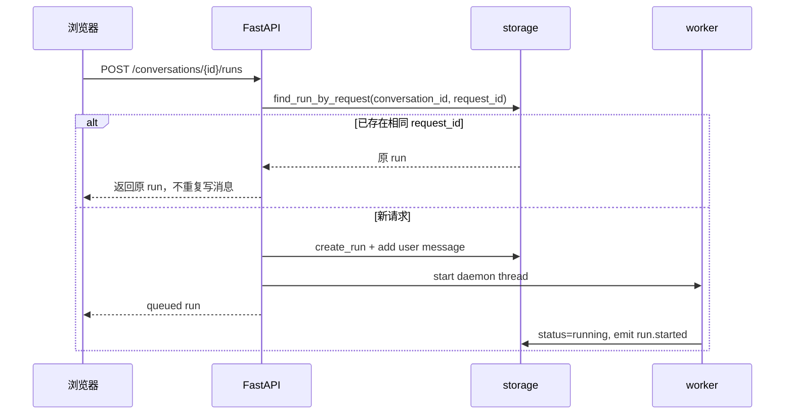

# 数据流（Data Flow）

> 一道题从 `solve()` 进入，到 `final_response` 出厂，**每一步做了什么、在哪些点分叉、每个分支的条件是什么、失败后降级到哪里**。
> 全部内容与当前代码一一对应，引用格式为 `文件::函数`。常量取自 `config.py`。

---

## 0. 一分钟速览（总拓扑）

```
solve(problem, metadata)
  │  user_agent.py::ReasoningAgent.solve
  ├─ create_initial_state ── 定 question_mode、打题面锚(sha256)
  └─ MathAgentGraph.run ──── 建 TokenBudget / TimeBudget / DatabaseClient / Deps
        │
        ▼  主图（langgraph_math_agent.py::build_math_agent_graph）
     START → input → classifier → ┌──────────────┐ → route_after_solving ─┬→ coordinator → END
                                  │ solving 子图 │                        ├→ reconciliation ─┐
                                  └──────────────┘                        └→ semantic_arbiter ─┘
                                            ▲                                    │
                                            └───────── next_node="solving" ──────┘
        │
        ▼  solving 子图（graph/solving_subgraph.py::build_solving_subgraph）
     START → database_retrieval → fan_out（条件扇出）
                 ├─→ reasoning_agent ─┬→（客观题）objective_review ─┐
                 │                    └─→（非客观）─────────────────┤
                 └─→ python_agent（条件：非客观；卡改写后不再短路）───┤
                                                                    ▼
                                                              cross_validator → END
        │
        ▼  出厂（user_agent.solve 尾部）
     _build_trace → 判分口径终门(边界，卡改写后空操作) → _validate_output → {"final_response", "trace"}
```

三条贯穿全程的横切线：
**① 卡片通道**（技能手册指纹命中 → 提示词置顶（纯推理卡）→ 出厂前终门仍挂载但已空操作）；
**② 时间预算**（软预算 900s / fast_path / 硬上限 1200s，层层钳制）；
**③ 降级兜底**（任何节点失败都转成状态字段，图继续走，最差也要交出可判分文本）。

---

## 1. 入口层

### 1.1 批处理入口 `main.py`

```
load_jsonl(input_file)                       每行 {idx, problem}；无 idx 用行号
 → InternChatClient()                        读 INTERN_API_KEY（缺失即抛）
 → ReasoningAgent(client=client)             平台注入 client 时也走同一构造签名
 → asyncio.Semaphore(LOCAL_MAX_CONCURRENCY)  默认 8，环境变量可覆盖
 → process_item：结果文件已存在且非空 → 跳过（断点续跑）
     ├─ asyncio.to_thread(solve_item, agent, item)   同步 solve 丢线程池
     └─ write_json（临时文件 + replace 原子落盘）→ {output_dir}/{idx}.json
 异常：单题捕获 → {"status":"error","final_response":""}，不中断批次
```

### 1.2 唯一评测入口 `user_agent.py::ReasoningAgent.solve`

```
meta = metadata if isinstance(metadata, dict) else {}     ← 非 dict 不抛异常
idx  = meta.get("idx", -1)
try:
    initial      = create_initial_state(problem, meta)
    final_state  = MathAgentGraph.run(initial, token_budget=TokenBudget())
    result       = {"final_response": final_state.get("final_response", "无法生成答案"),
                    "trace": _build_trace(final_state)}
    _apply_card_convention(problem, result)   ← 出厂终门（第 5 节）
    _validate_output(result)                  ← dict / 非空字符串 / 可 JSON 序列化
except Exception:  → {"final_response": "解题过程中出现错误…", trace:[{step:"error"}]}
                     （同样再过一次出厂终门）
```

### 1.3 初始状态 `state/math_agent_state.py::create_initial_state`

| 字段 | 值 | 说明 |
|---|---|---|
| `problem` | 原题文本 | 全程不可变（由题面锚校验保护） |
| `metadata` / `idx` | 调用方传入 | idx 缺省 -1 |
| `question_mode` | `mode_from_metadata(...) or classify_question_mode(problem)` | 见下 |
| `problem_anchor` | `{text, length, sha256, idx}` | 防重试分支改写题面 |
| `reasoning_attempts` / `python_attempts` / `semantic_arbiter_attempts` | 0 | |
| `answer_locked` | False | 仲裁锁定标志 |
| `errors` / `validation_history` | [] | reducer 字段（可并行写） |

**question_mode 判定顺序**（`utils/problem_profile.py::classify_question_mode`，先命中先返回）：

1. `true_false` —— 命中判断题标记（判断题/正误题/对错题/“判断下列命题”…）
2. `choice` —— 选项标记 ≥2 个，或“选择题/单选/多选/下列…正确…”
3. `fill` —— 填空词/连续下划线/空括号
4. `proof` —— 行首“证明/试证”、英文 prove/show…、或**作答指令式**“请给出证明/举出反例/并证明…”
5. 其余 → `computation`

> 该 mode 决定后面所有分支：客观题（choice/true_false/fill）走短路径、不跑 Python；proof 出厂时保留证明正文。
>
> `true_false` 内部再分单条/多条（`judgement_item_count`：编号 (1)(2)…／行首列表项／下划线空位 ≥2）：
> 多条判断题的作答契约、归一化（`_extract_multi_verdicts`）与可用性检查都要求**按条目逐条写全**
> （条目不全判不可用→重试），且判定词随题面措辞（"成立/不成立" vs "正确/错误"）。
> 2026-10-02 决赛 idx 13（五连判断）曾被单条契约折叠成一条"错误"，即由此修复。

### 1.4 图运行 `langgraph_math_agent.py::MathAgentGraph.run`

```
TokenBudget()                    max 256000 tok；≥90% → tight（重试降为 1 次、调解限 1 轮）
TimeBudget()                     total=1200s 硬上限；reserve=300s；fast_path 阈值=300s
DatabaseClient(db_dir="database", device="cpu")   进程级单例（懒加载 ChromaDB）
Deps(client, skills_loader, mcp_client, token_budget, time_budget, db_client, logger)
app.invoke(initial_state, config={"configurable": {"deps": deps}})
  ↓ 结束后附：_time_budget 快照 + _llm_spend_log（进 trace.timing）
```

**三档时钟**（`utils/time_budget.py`）：

```
0s                              900s(软)        1200s(硬)
├──────── 可选阶段自由花钱 ────────┼── reserve 300s ──┤
                            可选 LLM 阶段从此停止购买   平台硬限
fast_path = 剩余硬时间 < 300s：跳过所有重试与二次机会阶段
```

---

## 2. 节点包装层 `utils/error_handler.py::node_wrapper`（每个节点都经过）

执行顺序（对主图与子图每一个节点统一生效）：

```
1. get_deps(config).time_budget（拿不到也不影响）
2. verify_problem_anchor(state)
     ├─ 题面仍等于锚 → 通过
     ├─ 锚有效但题面被改写 → 事件 action="repair"，用锚文本替换后继续
     └─ 锚自身损坏 → action="anchor_corrupt"，同样以锚文本为准
3. timeout = resolve_timeout(name, clock) = min(该节点上限, 剩余硬时间, 下限 1s)
4. run_with_timeout(node, timeout)         线程池执行；超时抛 NodeTimeoutError，
                                           线程不等待（无法真杀，交给 socket 超时）
5. 失败 → _fallback_for_node(name,…)       按节点返回"合法但降级"的状态增量（见第 8 节）
6. clock.record("node:<name>", 耗时)；结果里追加 node_timings；题面完整性事件写 state
```

**节点上限表**（`config.node_timeouts`，都会被第 3 步按剩余硬时间再钳一次）：

| 节点 | 上限 | 节点 | 上限 |
|---|---:|---|---:|
| input | 5 | python_mcp_execute（单次执行） | 60 |
| classifier | 200 | cross_validator | 15 |
| solving（子图整体） | 1150 | reconciliation | 10 |
| reasoning_agent | 1100 | semantic_arbiter | 150 |
| python_agent | 1100 | coordinator | 420 |

---

## 3. 主图逐节点

### 3.1 `input`（≤5s）
取 `idx`，确定 `question_mode`（metadata 优先，其次题面判定）。

### 3.2 `classifier`（≤200s）—— `nodes/classifier_node.py::classifier_node`

```
stages = ["llm_prefill"]
① 预填充调用：prompt 附全部 18 个真实领域名；assistant 种子 '{"category": "'
   max_tokens=96（预填充下模型只吐领域名，实测 ~1s/12 tok）
   → _extract_decision → _resolve_category（精确→去标点→子串→最长公共子串→Levenshtein→关键词 top1）
   ├─ 命中且 confidence ≥ 0.85 → 采用                   家 stages=["llm_prefill"]
   └─ 命中但低置信          → 直接采用（low_confidence_accepted）  ← 只要给的是真实领域名
② 预填充完全解析不出（且不在 fast_path）：
   不带预填充的完整调用 max_tokens=8192（允许完整 CoT，实测可达 130s+）
   → 仍解析不出 → stages += "llm_plain" / 低置信同样采信
③ 都失败或 fast_path → 确定性兜底：关键词表（DOMAIN_ALIASES/PRIORITY_TERMS）
   + TF-IDF 索引合并排序 top1，confidence=0.0，stages += "deterministic_fallback"
输出：category / category_confidence / candidate_categories / classification_stages_used
```

> 分类只决定"加载哪一册技能手册"；**卡片是跨册命中的，与分类无关**。

### 3.3 `solving` 子图（≤1150s）
见第 4 节。产出的关键状态：`reasoning_result`、`python_output`、`validation_status`、
`validated_answer`、`next_node`、`objective_review_result`。

### 3.4 路由 `route_after_solving`
```
should_terminate == True            → coordinator
next_node ∈ {reconciliation, semantic_arbiter} → 对应节点
其余（match / 无指示）               → coordinator
```

### 3.5 `reconciliation`（≤10s）—— `nodes/reconciliation_node.py`（确定性，不调 LLM）

```
round_num = reconciliation_round + 1
max_rounds = 2；fast_path 或 token tight → 1

A. round_num >= max_rounds
     → next_node="semantic_arbiter"，status="reconciliation_exhausted_arbitrating"
B. reconciliation_retry_available == False（按"上一次实测耗时"定价，买不起）
     → next_node="semantic_arbiter"，status="reconciliation_budget_blocked"，budget_blocked=True
        （force 通道：仅一次 recheck_required 可用，需 硬剩余 ≥ 预估+240s）
C. 可重跑：
     python 执行失败         → python_retry_hint=修错提示          action="retry_python"
     python 成功但两路不一致  → 两侧都重跑（互不给对方答案）        action="retry_both"
     两路都没答案            → 通用重跑提示                        action="retry_both"
     next_node="solving"（回到子图，题面锚保护题面不被改写）
```
重跑提示会作为 `branch_hint` 随 Send 进入对应分支，并保留 skill 文档与字段契约（不裸发题面）。

### 3.6 `semantic_arbiter`（≤150s）—— 只选既有候选或弃权，绝不生成新数学文本

```
前置过滤：题面 > 上限 → skipped；候选池 < 2 → skipped（→ _fallback_result）
候选池 _candidate_pool：
  reasoning 候选（被反伪造标记的不入池；客观题不做交付物契约健康检查）
  objective_review 候选（仅客观题）
  python 候选（success 或 stdout_mined；fabricated 不入池；untrusted 带前缀入池）
  裸"无解"断言且无矛盾证据 → 剔除；不同来源同答案 → 去重
仲裁调用：
  注入 ①学科口径参考（卡片+类别节选 2200）②候选块（随机 nonce、随机顺序、去来源标签、
  包 UNTRUSTED 标记）③验证状态与理由
  预算检查：token 不够 → budget_exhausted；硬剩余 < 75s（arbiter_reserve_quota_s）→ time_exhausted
  ① prefill 调用 种子 "ARBITER_{nonce}="，max_tokens=96（实测 0.8s/4 tok）
     → 解析 SELECT:<候选ID> 或 ABSTAIN（只认绑定 nonce 的标记）
  ② 解析不出且不在 fast_path → 不带预填充的重试 max_tokens=4096
结果：
  选中 → _enforce_contract 契约兜底（仅在能证明另一候选严格更完整时改选）
         → validated_answer=选中文本，answer_locked=True（矛盾未决时 selected_unresolved，不锁）
  弃权/非法/机械失败 → _fallback_result：
         语义僵局(abstained) 且还能重试 → next_node="reconciliation"
         其余 → _preferred_answer 兜底 → next_node="coordinator"
```

### 3.7 `coordinator`（≤420s）—— 出厂路径全集，见第 9 节

### 3.8 路由终点
`route_after_reconciliation`：solving / semantic_arbiter / coordinator；
`route_after_semantic_arbiter`：reconciliation / coordinator；`coordinator → END`。

---

## 4. solving 子图（逐分支）

### 4.1 `database_retrieval`（纯增益节点，任何失败都降级为空）

```
db_client.query(problem, top_k=db_retrieval_top_k=2)
  → 每条算 similarity（cosine）
  → 门控：similarity < db_reference_min_similarity=0.55 → 丢弃（日志 "dropped #k … below 0.55"）
  → partition_reference_examples（utils/reference_block.py）：
      偶数名次 → reasoning 分支（保留解答）
      奇数名次 → python 分支（**抹掉解答**，只留题面与参数差异）
      附反锚定说明 + 规模数字差异提示（"参数不同则结论不同"）
输出：retrieved_examples / reasoning_references / python_references / reference_partition
失败（无 deps、空题面、DB 异常）→ 空结果，绝不阻断子图
```

### 4.2 `fan_out`（条件扇出，`Send` 并行）

| 条件 | 扇出 |
|---|---|
| 客观题（choice/true_false/fill） | 只 → `reasoning_agent`（内部完成自查；随后经 `objective_review`） |
| 非客观 且 `card_short_circuit_python=True` 且题面命中**带核定值的卡片** | 只 → `reasoning_agent`（卡片已给核定结论，终门兜底）；**2026-10-02 卡改写后不存在带核定值的卡，该行实际不再触发** |
| 其余 | → `reasoning_agent` ＋ `python_agent`（并行） |

`route_after_reasoning`：客观题 → `objective_review` → `cross_validator`；否则直接 `cross_validator`。

### 4.3 `reasoning_agent`（≤1100s）

**提示词装配（两路共用素材）**
```
REASONING_PROMPT.format(skill_document, problem, category, model_name)
  skill_document = 卡片(置顶不截断) + 按主题选的类别模块（预算 4000）
                 + 检索参考区块（reasoning 侧，含解答与反锚定）
  += mode_instruction(question_mode)      题型作答要求
  += structure_instruction(problem)       题面结构检查单（求所有解/极值/开区间/序数/可行性+计数…）
  （重试时）+= "\n\n[复核提示] " + branch_hint
```

**A. 客观题短路径**（choice/true_false/fill）
```
contract = 两行："答案：…" + "依据：…"；检出实算标记（分裂域/维数/阶/收敛半径…）
           → 三行："核对：…" + "答案：…" + "依据：…"
domain_guard：抽象代数分裂域 → 机械核验步骤；填空 → 空位数由代码数好写进提示
① 普通调用 max_tokens=4096, temp=0.2
   解析（normalize_objective_answer）→ 语义核验 objective_answer_consistency
   （填空还须 fill_answer_matches_blanks）→ 全过即返回
② 不合格 → prefill 重试（种子 "答案："）
   新答案"不比首轮更残缺"才替换；保留 incomplete_answer 供诊断
③ 仍无答案且不在 fast_path → 压缩四章节升级（prefill "## 问题分析\n"）
   （压缩指令保留 answer_coverage_clause：全部解/多问项/计数必须覆盖）
trace 记 objective_plain / unparsed / fill_blank_mismatch / semantic_mismatch / 升级结果，附 raw_excerpt
```

**B. 解答/证明路径**
```
max_attempts = 2（token tight 或 fast_path → 1）
每轮先做"买得起吗"检查：can_afford_retry(clock,"reasoning") 按**上次实测耗时**定价
① chat_with_retry（max_tokens=24576）→ 解析四章节
   （## 问题分析 / ## 详细解题步骤 / ## 最终答案 / ## 关键验证点）
   ├─ 完整 → 返回（answer_source=parsed_sections）
   ├─ 解析不出 → 结论捞回（salvage_conclusion：要求结论词+实质内容+过碎片门）
   │              answer_source=salvaged_prose / fallback_line
   ├─ token 耗尽（_looks_token_exhausted）→ 压缩重试（见③）
   └─ 格式缺章节 → 追加格式提醒重试一次
② 传输异常（如 280s 读超时）→ **不弃分支**：保留已解析内容，直接转压缩重试 ③
③ 压缩重试 _compressed_reasoning_retry：
   prefill 种子 "## 问题分析\n"，max_tokens=8192（~150s），
   定价走 reserve_margin=150s（软预算已尽也放行，硬限前够本+余量即可）
   产出的任何章节都优于空产出；补齐章节但没写结论时保留此前捞回答案
输出：reasoning_result{analysis,steps,answer,validation_points}
     + answer_source + reasoning_raw_response + reasoning_reference_chars
```

### 4.4 `objective_review`（仅客观题）—— 独立第二意见
```
注入：题面 + question_mode + 学科口径参考（卡片+类别节选 2200）
调用：prefill 种子 "答案："（~35s 预期）
解析 → normalize_objective_answer → 可用性/填空空位/语义一致性检查
输出：objective_review_result（answer / invalid_answer / incomplete_answer 三态）
失败：返回空结果，不阻断（cross_validator 仍可用首答）
注：该节点没有专属上限（config.node_timeouts 无此键），实际被钳到剩余硬时间。
```

### 4.5 `python_agent`（≤1100s）

```
客观题 → 直接返回 skipped（success=False, reason="objective_mode"），不生成代码
否则：
  candidate_answer = reasoning_result.answer（作为"待核验候选，不可信"注入）
  prompt = PYTHON_PROMPT.format(验证示例节选 2000 + python 侧参考(无解答))
         + structure_instruction + [技能知识点参考](卡片+类别节选 1600)
         + 待核验候选块（明确要求独立核对、不得盲从）
  max_attempts = python_max_retries=3（token tight 或 fast_path → 1）

循环：
  ① 生成（chat_with_retry, max_tokens=24576）
  ② 抽取代码 _extract_code：独立 ```python``` 围栏 → 不规范围栏但内容像代码 →
     无围栏时从首个 import/from 起
     ├─ 抽不到代码：
     │    响应很长（CoT 吃满额度）→ 压缩重生成（prefill "```python\n"）
     │    否则 → 格式重试（"只输出一个代码块…"）
     ├─ 缺 print("最终答案:", …) → **仍然执行**（stdout 常已有结论），trace 记 missing_answer_print
     └─ 执行：mcp_client.execute(code, timeout=60)
          优先子进程（临时 .py + 干净环境变量 + UTF-8 钉死）；异常回退进程内 exec
          抽取：stdout 中**最后一个** "最终答案:" 之后的内容（多行完整保留）
  ③ 判定本轮产出：
     执行失败     → 若尚未用过压缩重试且买得起 → 压缩重生成；否则按剩余额度重试
     执行成功     → 进入证据化
  ④ 传输异常     → 保留已有 last_output 不丢分支 → 压缩重生成兜底

证据化 finalize（utils/verification_evidence + verification_authenticity）：
  静态反伪造：有无实质计算（循环/求解调用/变量算术）？答案是否字面量直印？
             高风险题（计数/极值/DP…）是否有独立小规模基准断言？
  → python_output{success, stdout, stderr, answer, execution_time, execution_backend,
                  evidence_status(support/contradict/inconclusive), evidence_summary,
                  authenticity{fabricated, verified, reasons}, contradictions}
  → answer_source=stdout_mined（stdout 二次挖掘）
```

### 4.6 `cross_validator`（≤15s，纯确定性）—— 决定下一跳

```
question_mode = state.question_mode（判定优先级最高）
客观题：归一化候选 → 可用性/空位/一致性检查 → 直接给
        status=match（空位不足时 uncertain，confidence 0.45）→ 只带一个候选
非客观题：
  AnswerMatcher.match_answers(reasoning, python, problem) → match / uncertain / mismatch
  problem_type = detect_problem_type(problem)（proof / computation）
  证据优先规则：
    python evidence_status=="contradict" 且候选非伪造、非截断、与推理不同，
      且**题面未命中参考卡** → 兜底选 python（被自家验证器反驳的答案不得出厂）
    命中的是参考卡题型 → 不走机械偏袒，交给带口径的仲裁
  routing：
    match（且推理完整）        → next_node="coordinator"
    mismatch + 还能重跑        → next_node="reconciliation"，status="mismatch_reconciling"
    mismatch + 额度耗尽        → next_node="semantic_arbiter"，status="mismatch_arbitrating"
    uncertain                 → next_node="semantic_arbiter"，status="uncertain_arbitrating"
    python 证据明确矛盾        → recheck_required=True（可购买一次强制复核，reserve 240s）
输出：validation_status / validation_details{status,verdict,method,problem_type,
      evidence_status, contradictions,…} / validated_answer（_preferred_answer 兜底）
      / candidate_health / validation_history / next_node
```

> `_preferred_answer`（仅兜底用，不参与正常匹配路径）：证据指向谁选谁 > 契约更完整者 >
> 推理 > python；**命中参考卡的题跳过"计算题偏袒 Python"两条规则**。

---

## 5. 横切一：卡片通道（解法直达·纯推理版）

```
手工/离线建卡（技能手册任意一册）：
  ## 模块速查：解法直达·<标题>
  - 检索词：…
  - 命中条件：<指纹词…>               ← 空白分隔，全部命中（大小写无关的子串匹配）
  **推理过程**：1) … 2) …（每步都写到"差一步机械运算"为止）
  **自检**：…

  2026-10-02 改写要点：卡片**只保留推导链**，不再写"判分口径/结论先行"；
  最终标量答案不落卡（推到约分/取整/代入前一瞬即停），
  公式/对象型结论（解集、多项式、分布函数等）是推导的自然产物，保留。

运行期：
  ① 进程首次使用时建索引：扫描全部 18 册，只收带"命中条件"的模块（缓存+锁）
  ② matched_cards(problem)：题面 casefold 后逐词子串判定，**全中才算命中**
     —— 与分类结果无关（跨册可见）
  ③ select_excerpt_with_cards(doc, problem, limit)：
     命中卡整段**置顶且不截断**；剩余额度给类别节选（下限 1200 字符）
     调用点：reasoning 4000 / 客观 2200 / python 1600 / objective_review 2200 / arbiter 2200
  ④ is_card_covered(problem)：基于 canonical_value ⇒ 卡改写后恒为 False
     ⇒ card_short_circuit_python 实际失效，所有非客观题恢复 reasoning+python 双支路
  ⑤ 判分口径终门 card_authority.enforce(problem, final_response)：
     canonical_value 解析"判分口径（…）："行（花括号配平扫描，支持嵌套 \boxed）；
     卡里已无此行 ⇒ 恒返回 "" ⇒ enforce 原样放行。
     代码与挂载点（coordinator 出口 + solve 边界）保留，
     作为将来若重新引入核定值时的护栏；当前为**空操作**。
```

**不变量**：每张卡的指纹必须对目标测试集**全量唯一**（否则会串题并按错口径改写）。
离线审计：`dev_test/fp_audit.py`、`audit_staged.py`、`exposure_check.py`（零 API）。

---

## 6. 横切二：时间与预算决策

| 机制 | 触发条件 | 效果 |
|---|---|---|
| 软预算 `remaining()` | total(1200) − reserve(300) − elapsed ≤ 0 | 停止购买可选 LLM 阶段，走确定性兜底 |
| `fast_path()` | 剩余硬时间 < 300s | 重试次数降 1、跳过二次机会（仲裁 prefill 除外）、跳过分类升级 |
| 节点上限 | 每节点 | `min(上限, 剩余硬时间)`；超时 → 该节点降级结果 |
| 重试定价 `can_afford_retry` | 每次重试前 | 用**上一次实测耗时**做预算，买不起就记 `retry_unaffordable` 并放弃 |
| 压缩重试定价 | token 耗尽/传输失败 | `reserve_margin` 模式：软预算已尽也放行，要求 硬剩余 ≥ 150s（reasoning/python） |
| 仲裁配额 | 硬剩余 ≥ `arbiter_reserve_quota_s`=75 | prefill 仲裁（~10s）照常执行，防止难题全跳过仲裁 |
| 应急直答配额 | 硬剩余 ≥ `emergency_reserve_quota_s`=90 | 双分支全灭时用 reserve 发一次种子直答（~30s） |
| 强制复核 reserve | `forced_recheck_reserve_s`=240 | 一次性的矛盾复核预算，独立于软预算 |
| 传输卡死熔断 | 单次调用耗时 ≥ 224s（0.8 × 280s socket 超时） | `LLMRetryWrapper` 不再重试满长调用，直接让调用方走压缩路径 |
| Token tight | 消耗 ≥ 90% × 256000 | 节点重试降 1；调解轮次上限降 1 |

---

## 7. 状态字段：谁写、谁读（关键项）

| 字段 | 生产者 | 消费者 |
|---|---|---|
| `category / classification_stages_used` | classifier | 各节点取技能手册；trace |
| `retrieved_examples / *_references` | database_retrieval | reasoning、python（互相隔离的两份） |
| `reasoning_result / answer_source` | reasoning_agent | python_agent（候选）、cross_validator、coordinator |
| `python_output / authenticity / evidence_status` | python_agent | cross_validator、semantic_arbiter、coordinator |
| `objective_review_result` | objective_review | semantic_arbiter（第二候选） |
| `validation_status / validation_details / validated_answer / next_node` | cross_validator | 主图路由、coordinator |
| `reconciliation_round / *_retry_hint` | reconciliation | 子图（branch_hint）、路由 |
| `semantic_arbiter_status/decision / answer_locked` | semantic_arbiter | coordinator（锁定则逐字出厂） |
| `final_response / coordination_detail / fallback_source` | coordinator | user_agent.solve → 评测方 |
| `node_timings / errors / problem_integrity_events` | node_wrapper | trace（reducer 字段，可并行写） |

---

## 8. 错误与降级矩阵（`_fallback_for_node` + 各节点内部兜底）

| 节点出错 | 落到的状态 | 下游如何继续 |
|---|---|---|
| classifier | category="非基础及进阶课程"，confidence 0，stages=["error_fallback"] | 照常求解（卡片跨册，不受影响） |
| database_retrieval | 空参考 | 两分支用 skill 文档/卡片照常求解 |
| reasoning_agent | 空 reasoning_result + trace 留证 | python 照常；至少还有一个候选 |
| objective_review | 空 review | 首答仍可经仲裁/兜底出厂 |
| python_agent | success=False + stderr（经证据化） | cross_validator 走仅推理路径 |
| cross_validator | status="uncertain"，next_node="coordinator" | coordinator 兜底选答案 |
| reconciliation | 提示置空，next_node="coordinator" | 不再重跑 |
| semantic_arbiter | status="error"，必要时 _preferred_answer | coordinator |
| coordinator | 见第 9 节尾部的兜底链 | 仍保证非空 final_response |

---

## 9. 出厂路径全集（coordinator → final_response）

按代码顺序（先命中先返回）：

```
1. 客观题：validated_answer 直接出厂（填空先 format_fill_submission；空位不匹配则清空）
2. answer_locked=True：逐字出厂（证明题附 build_proof_body）
3. 超时守卫 out_of_time（软预算耗尽；非证明题 fast_path 也算）：
     ├─ 有答案 → 直接出厂（证明题附证明正文）
     └─ 无答案 → 应急直答（种子"最终答案："，~30s）→ 数据库参考兜底 → 部分结论兜底
4. 正常路径：COORDINATOR_PROMPT → LLM（max 16384）→ strip_cot_prefix
   → post_process_final_response(cleaned, validated, ptype, problem)
       非证明题收敛为纯答案；证明题保留正文
       缺字段时从完整说明中回捞（\boxed{} → 选项句式 → 结论标签行）
5. 叙述宣布"无法确定" → 应急直答 → 数据库参考 → 部分结论 → 保留叙述
6. LLM 不可用/异常 → 有答案直接出厂；无答案走 5 的兜底链
7. 兜底链（_partial_response）：捞回结论 → python 答案 → stdout 挖掘 → 结构化部分结论
   → 推理尾部（须过噪声门）→ 通用失败说明
8. 最后：判分口径终门（coordinator 出口 + solve 边界；卡改写后空操作）→ _validate_output
```

`coordination_detail` 始终保存 coordinator 原文（进 trace）；锁定时为空是正常行为。

---

## 10. trace 结构（审计用，不参与打分）

按序可能出现：`classification` → `database_retrieval` → `reasoning` → `python_verification`
→ `validation` → `validation_history` → `problem_integrity` → `semantic_arbitration`
→ `reconciliation` → `coordination` → `timing`（+ solve 边界可能追加 `card_convention_gate`）。

要点：`reasoning.thinking.answer_source`（parsed_sections/fallback_line/salvaged_prose/
compressed_prefill）与 `raw_response_excerpt` 用于区分"模型答错"与"解析器漏掉"；
`python_verification.thinking.evidence_status/verification_trusted/authenticity_reasons`
解释 Python 候选为何被采信/排除；`timing.tools[0]` 含三档预算快照、逐节点耗时与每次
LLM 调用耗时（`_llm_spend_log`）。

---

## 11. 关键常量速查（`config.py`）

```
模型        intern-s2（INTERN_MODEL 可覆盖）
时间        problem_time_budget_s=1200  time_reserve_s=300  time_fast_path_threshold_s=300
配额        arbiter_reserve_quota_s=75  emergency_reserve_quota_s=90
            forced_recheck_reserve_s=240  compressed_reserve_margin_s=150
重试        max_retries_per_node=2  python_max_retries=3  llm_max_retries=3  reconciliation_max_rounds=2
Token       reasoning/python=24576  coordinator=16384  objective_reasoning=4096
            *_compressed=8192  classifier=96(→fallback 8192)  arbiter=96(→4096)  emergency=1280
            token_budget_max=256000  warn_ratio=0.9
检索        db_retrieval_top_k=2  db_reference_min_similarity=0.55
分类        classifier_confidence_threshold=0.85  classifier_top_k=3（只用于确定性兜底）
卡片        card_authoritative_answer=True  card_short_circuit_python=True
            （两者均依赖卡内"判分口径"行；2026-10-02 卡改写后无此行 ⇒ 实际均为空操作）
```

---

## 12. 文件索引（按数据流顺序）

| 阶段 | 文件 |
|---|---|
| 批处理入口 | `main.py` |
| 评测入口/边界终门 | `user_agent.py` |
| 图装配/预算注入 | `langgraph_math_agent.py`、`state/math_agent_state.py`、`utils/deps.py` |
| 节点包装（超时/降级/锚） | `utils/error_handler.py`、`utils/timeout_control.py`、`utils/problem_anchor.py` |
| 主图节点 | `nodes/input_node.py`、`nodes/classifier_node.py`、`nodes/reconciliation_node.py`、`nodes/semantic_arbiter_node.py`、`nodes/coordinator_node.py` |
| 子图 | `graph/solving_subgraph.py`、`nodes/database_retrieval_node.py`、`nodes/reasoning_agent_node.py`、`nodes/objective_review_node.py`、`nodes/python_agent_node.py`、`nodes/cross_validator_node.py` |
| 提示词素材 | `utils/skills_loader.py`、`utils/skill_excerpt.py`、`utils/solution_cards.py`、`utils/reference_block.py`、`utils/problem_profile.py`、`utils/prompt_templates.py` |
| 答案理解/闸门 | `utils/answer_matcher.py`、`utils/answer_extractor.py`、`utils/answer_contract.py`、`utils/answer_formatter.py`、`utils/structured_answer.py`、`utils/answer_cleanliness.py`、`utils/cot_stripper.py`、`utils/conclusion_salvage.py`、`utils/stdout_miner.py`、`utils/candidate_health.py` |
| 验证与仲裁支撑 | `utils/verification_evidence.py`、`utils/verification_authenticity.py`、`utils/reconciliation_policy.py`、`utils/retry_affordability.py` |
| 预算 | `utils/time_budget.py`、`utils/token_budget.py`、`utils/llm_retry.py`、`utils/prefill.py`、`utils/client_tuning.py` |
| 卡片终门 | `utils/card_authority.py` |
| 代码执行 | `utils/python_mcp_client.py`、`mcp_servers/python_executor/server.py` |
| 离线审计（开发用） | `dev_test/fp_audit.py`、`dev_test/audit_staged.py`、`dev_test/exposure_check.py`、`dev_test/test_boundary_gate.py` |

---

## 13. Web Demo 数据流（当前实现）

本节补充网页工作台的实际数据流。核心求解器仍由前文描述；网页只增加会话、运行
调度、事件持久化和展示适配，不另写一套数学求解逻辑。

### 13.1 分层总览

```mermaid
flowchart LR
    Browser[React 浏览器] -->|POST message| API[demo_server.app]
    API --> Route[conversation_service.resolve_request]
    Route --> Run[start_run]
    Run --> DB[(SQLite conversations/messages/runs/events)]
    Run --> Worker[后台线程 _execute]
    Worker --> Replay[fixtures replay]
    Worker --> Live[user_agent.ReasoningAgent.solve]
    Live --> Graph[LangGraph 主图与 solving 子图]
    Graph --> Sink[EventSink]
    Replay --> Sink
    Sink --> DB
    DB --> SSE[GET /api/runs/{id}/events]
    SSE --> Browser
    Worker --> Result[最终 final_response + trace]
    Result --> DB
    Browser -->|GET conversation / run| DB
```

一条网页提问的顺序是：

1. 前端确认当前聊天存在且该聊天没有另一个运行，立即把用户消息放入当前视图。
2. `POST /api/conversations/{conversation_id}/runs` 调用
   `demo_server.run_service.start_run()`。
3. `start_run()` 根据消息选择 `solve`、`follow_up` 或 `explain` 路径，创建 `runs` 行，
   保存 user message，并启动独立后台线程。
4. 后台线程创建该运行专属的 `EventSink(run_id)`，先写入 `run.started`，再执行回放或
   `ReasoningAgent.solve(..., event_sink=sink)`。
5. `EventSink` 为每个运行维护独立的 `seq`、节点执行 ID 和 attempt；事件写入 SQLite，
   SSE 只读取这个 `run_id` 的事件。
6. 前端收到事件后按节点合并临时 trace：`node.started` 创建运行中阶段，
   `node.completed`/`node.degraded` 更新同一阶段并附加详情。
7. 后台线程把最终 assistant message 和聚合 trace 写入数据库，再把 run 标记为
   `completed`；失败时写 `run.failed` 和可读错误。

### 13.2 会话、运行和消息的关系

```text
conversation (1)
 ├── messages (N)
 │    ├── user message      run_id → 对应运行
 │    └── assistant message run_id → 对应运行，trace_json → 最终阶段详情
 └── runs (N)
      └── events (N)        run_id + seq 唯一
```

`conversations` 只表示聊天窗口；一次用户提问对应一个 `run`。一个聊天可以有多次
连续提问，但同一聊天的前端在已有运行时不会再次提交，避免同一窗口内状态难以解释。
不同聊天之间没有这个限制，可以同时运行。删除聊天由 SQLite 外键级联删除其消息、
运行和事件。

默认数据库是 `demo_data/icma-demo.sqlite3`，可以用 `ICMA_DEMO_DB` 改变路径。每个
SQLite 请求单独打开连接，后台求解线程和 SSE 读取线程不会共享连接对象。

### 13.3 请求创建和幂等



`request_id` 的唯一索引是 `(conversation_id, request_id)`。它只在同一聊天内去重，
不同聊天即使使用相同字符串也互不影响。前端为每次提交生成新的 ID；SSE 断线重连
不会重新 POST，也不会重启后台线程。

### 13.4 回放、解释和真实求解

`run_service._execute()` 有三条入口：

| 路径 | 条件 | 数据来源 | 是否需要 API Key |
|---|---|---|---|
| `replay` | `mode=replay` | `fixtures.get_example()` 和 `replay_events()` | 否 |
| `explain` | `resolve_request()` 命中“解释上一轮” | 当前聊天最后一个 assistant message | 否，当前适配层使用本地解释文本 |
| `live` | 其余真实求解 | `ReasoningAgent.solve()` | 是 |

回放循环对每个 fixture stage 依次发出：

```text
node.started(node=stage.node)
等待 ICMA_REPLAY_DELAY
node.completed(node=stage.node, payload={summary, thinking, tools, elapsed_s})
```

真实求解中，`utils.error_handler.node_wrapper()` 包装主图和子图节点。在节点开始时
发送 `node.started`；节点正常返回时发送 `node.completed`；节点异常经过
`_fallback_for_node()` 后发送 `node.degraded`。payload 会按节点提取可展示证据：

- `classifier`：领域名、`skills_pythonscripts/<领域>`、skill 文档、验证脚本和候选领域。
- `database_retrieval`：检索问题、相似度、来源、两条参考题及解法。
- `reasoning_agent`：分析、steps、阶段结论、验证要点和 reasoning 工具记录。
- `python_agent`：生成代码、stdout、stderr、执行后答案和证据状态。
- `cross_validator`：比较结果、验证状态、矛盾和选择的答案。
- `reconciliation`/`semantic_arbiter`/`coordinator`：重试、仲裁和最终整理的阶段信息。

完整最终 trace 仍由 `user_agent.py::_build_trace()` 生成。事件 payload 是实时展示
快照，不能替代最终结果；最终答案始终以 `solve()` 返回并通过边界校验后的
`final_response` 为准。

### 13.5 事件协议和生命周期

事件表的最小结构如下：

```json
{
  "schema_version": 1,
  "run_id": "uuid",
  "seq": 7,
  "type": "node.completed",
  "node": "reasoning_agent",
  "node_run_id": "uuid",
  "round": 0,
  "attempt": 1,
  "timestamp": "2026-10-26T05:00:00.000+00:00",
  "payload": {
    "summary": "reasoning_agent 完成",
    "elapsed_s": 12.5,
    "thinking": {"steps": [], "result": "..."},
    "tools": []
  }
}
```

当前使用的事件类型：

| 事件 | 写入位置 | 页面效果 |
|---|---|---|
| `run.started` | `run_service._execute` | 运行开始，建立运行上下文 |
| `node.started` | `node_wrapper` 或回放循环 | 拓扑节点变为运行中，思考面板出现阶段 |
| `node.completed` | `node_wrapper` 或回放循环 | 阶段变为完成并显示 thinking/tools |
| `node.degraded` | `node_wrapper` | 阶段显示降级完成及可用证据 |
| `run.completed` | `run_service._execute` | 保存 assistant message，停止轮询和 SSE |
| `run.failed` | `run_service._execute` | 保存错误，页面显示失败状态 |

SSE 请求支持 `?after=N`：服务端只返回 `seq>N` 的事件。浏览器同时使用事件序号
去重和运行状态轮询；连接异常时先查询 `/api/runs/{id}`，运行未结束才重新连接。
终态 run 的事件流在没有新事件时自然结束。

### 13.6 前端状态隔离

`web/src/main.jsx::App` 维护：

```text
runStates[conversationId] = {
  runId,
  events,
  trace,
  running,
  starting,
  pending
}
```

`resourcesRef` 以 `runId` 保存每个 SSE、重连计时器和轮询计时器；
`finalizedRunsRef` 防止同一个运行重复收尾。切换聊天时：

1. 递增选择令牌，避免较慢的历史请求覆盖新选择。
2. 读取目标聊天最后一个 run 和消息。
3. 已完成 run 直接加载事件和最终 trace；未完成 run 建立该 run 的 SSE。
4. 只把目标聊天的 `runStates[id]` 传给侧栏拓扑和消息面板。

因此，聊天 A 的事件不会更新聊天 B 的节点图，聊天 A 后台运行时也不会阻塞“新聊天”
和历史聊天切换。临时 assistant message 只存在于当前运行的视图；运行完成后由数据库
中的正式 assistant message 替换。

### 13.7 阶段详情渲染

`web/src/main.jsx` 的展示链为：

```text
SSE event.payload
  → mergeTraceEvent()
  → TracePanel
  → TraceItem（默认摘要，可展开）
  → TraceDetails
      ├─ thinking → TraceValue（对象、数组、Markdown、LaTeX）
      └─ tools    → ToolCall（details 折叠）
```

字段按语义选择渲染方式：

- `python_code`、`code`、`stdout`、`stderr` 使用等宽代码块并限制最大高度。
- `references`、`steps`、`validation_points` 使用可读列表或数组项。
- 普通字符串经过 Markdown + LaTeX 渲染，结构化对象显示中文字段标签。
- 工具调用使用原生 `details/summary`，默认展开该阶段的第一项工具。
- 阶段没有详情时明确显示“这个阶段没有额外的结构化详情”，不伪造内容。

### 13.8 故障、断线和恢复

| 场景 | 后端行为 | 前端行为 |
|---|---|---|
| 数据库检索失败 | 节点返回空参考并继续 | 检索阶段显示完成/降级，推理仍继续 |
| 单节点异常或超时 | `node_wrapper` 使用节点 fallback | 轨迹显示降级，后续节点继续 |
| 模型 Key 缺失 | run 失败并保存错误 | 当前聊天显示失败提示，其他聊天不受影响 |
| SSE 断线 | run 线程继续，事件留在 SQLite | 按 `after=lastSeq` 重连，不重复提交 |
| 浏览器刷新 | 不重启 run | 根据 `/api/runs/{id}` 恢复已完成或运行中的聊天 |
| 删除聊天 | 外键级联清理消息、运行和事件 | 当前聊天切到下一条历史，后台资源被关闭 |
| 运行中的聊天被删除 | 前端阻止删除 | 等运行完成后再删除，避免孤儿任务 |

### 13.9 本地验证路径

```powershell
conda activate competition
cd C:\Users\76234\Desktop\test\ICMA\ICMAnew
F:\anac\envs\competition\python.exe -m pytest -q
cd web
npm run build
```

手工检查顺序：

1. 启动 `uvicorn`，打开首页并创建两个聊天。
2. 在聊天 A 启动示例回放，立即切换到聊天 B，再新建聊天 C。
3. 返回聊天 A，确认阶段数和领域/参考题/推理/Python 详情只属于 A。
4. 在有足够长内容的聊天中滚动页面，确认桌面侧栏随页面移动；收起侧栏确认主窗口平滑扩张。
5. 刷新页面，确认已完成聊天恢复，运行中的聊天继续接收事件。
6. 删除一个历史聊天，确认其消息、run 和事件不再可读。

当前服务停止命令（PowerShell）：

```powershell
$listener = Get-NetTCPConnection -LocalPort 8765 -State Listen -ErrorAction SilentlyContinue
if ($listener) { Stop-Process -Id $listener.OwningProcess -Force }
```
